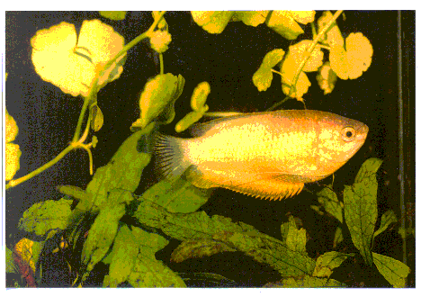
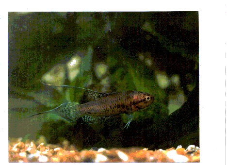

A fun fishkeeping quiz from our first website, compiled by David Marshall. The answers are at the bottom.

<!--more-->

Question 1 - Find an answer to this joke - Why are Lionfish unable to use electric shavers?

Q.2 - What does the genus name Apistogramma mean?

Q.3 - What colour would you expect to find on the tip of the dorsal fin of a Tinfoil Barb?

Q.4 - In the movie 'ET' what type of fish did Elliott keep in a Goldfish bowl?

Q.5 - 'Quiddle' is an alternative name for which well known sea creature?

Q.6 - True or False. The fish Colisa lalia is known in our hobby as the Dwarf Gourami?

*The fish in the photograph is the golden version of the Thick-Lipped Gourami, Colisa labiosa. This photograph is copyright of Mr. K. A. Webb.*

Q.7 - Name the four pigment colours which occur naturally in Goldfish?

Q.8 - What is the scientific name of the Painted Betta?

Q.9 - Upon the body of a Pumpkinseed Sunfish, Lepomis gibbosus, where would you find a 'flash of red'?

Q.10 - What is the correct scientific name for the fish known in the hobby as Rhinogobius wui?

Q.11 - How many scales are there on the lateral line of a Rudd, Scardinius erythrophthalmus?

Q.12 - To which country is Malpulutta kretseri endemic?

*Photograph of Malpulutta kretseri. Photograph is copyright of Mr. David Armitage. This fish achieved fame when a major aquarium fish food company used it on an endangered species calendar in the early 1980's.*

## Answers

Show the answers

Question one - Because Lionfish have no mains.

Q.2 - Unreliable line

Q.3 - Black

Q.4 - Guppies

Q.5 - The Squid

Q.6 - True

Q.7 - Yellow, black, red, orange

Q.8 - Betta picta

Q.9 - Behind the operculum (gill cover)

Q.10 - Ctenogobius disopilus

Q.11 - 40-43

Q.12 - Sri Lanka

