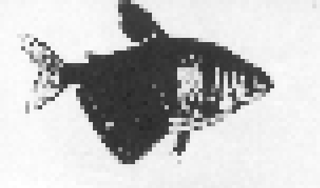
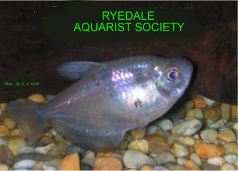

When the Ryedale Aquarist Club sprang into life, 1985, the members of the time decided that a Common Goldfish would make a really good emblem for the Club, as all of these members had kept a Goldfish at some time in their lives. At this time we were only affiliated to the Y.A.A.S.

<!--more-->

When the decision was taken, 1987, to expand our frontiers to membership of the F.B.A.S. we applied for the relevant membership forms etc. Along with these came a note to say that the F.B.A.S. were having a 'drive' that would encourage any new member Society to use a fish emblem not already in use by an established F.B.A.S. Society. As several such Societies were already using a Goldfish the rush was on to find a new emblem for what would now be the Ryedale Aquarist Society.

With a rough list of fish already in use an alternative to our Goldfish was fully discussed but the exact replacement proved difficult to come across. In the end our youngest member of the time, Miss Helena Olssen (who is now a wife and mother), was blindfolded, ran her fingers through a book of fish pictures and simply put a drawing pin into a page and this fell upon the Black Widow Tetra. We have used this fish for our posters etc. since this time and in cartoon, shadow and print image it has served us so well.

For our website David asked Mr. Kevin Webb, better known for his anabantid photographs, to do a proper photographic image of our 'old friend' and hope to have this in place in the near future but, for now, are using a paint image developed for us by Mr. Ron Marsden of W.A.S.P.

*The painted emblem by Ron Marsden, used on our first website from 2002.*

*Kevin Webb's photograph, which became our emblem on the website from 2005.*

Having heard about how we came to use this particular fish let us now look at a few facts and figures on the Black Widow Tetra:-

Scientific Name - Gymnocorymbus ternetzi

Distribution - South America

Famous Family - These fish are members of the large Characin family and you may know this family better through the famous Neon Tetra and infamous Piranha species. Characin species are not limited to South America and are naturally found in parts of Africa with feral colonies, escapees from tropical fish farms, occasionally appearing in the Far East. Your local aquatic retail outlet will carry several Tetra species so why not visit and browse?

Size - 5.5cm/3inches

Compatibility In Aquaria - A decent community fish, provided they are not kept with long-finned species, that will mix with fellow sized Cichlids, Doradids, Loricarins, Loaches and Characins.

Temperature - 20-26c

pH - 6 to 8.3

Breeding - Large males and females will form territories within the tank. Females are larger and more rounded looking and can be told apart from males through their anal fins as those of females are narrower and are said to run parallel with its second vertical line. Frenzied group spawning. Both sexes will eat eggs. If eggs are suspected remove adults and cover the tank with a blanket as the eggs are very susceptible to light.

We have taken just a short look at a very interesting little fish and have given you plenty of leads to both keep and find out more information about our 'old friend'.
