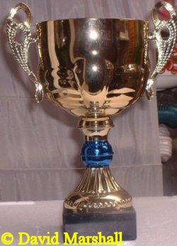

Steve Jones auctioning a small show tank as his trusty assistants Henry Hallsworth and Martin look on.

Prize Giving Dr. David Ford and Roy Blackburn

*A Special Trophy from the F.B.A.S.*

After so much planning and work the Ryedale Aquarist Society 20th Anniversary Day finally fell upon us.

On the morning of Sunday 13th March the sun shone beautifully. At 8.50a.m. Henry arrived to help ship raffle and food items etc. to the Pickering Centre of Askham Bryan College. Upon arrival we found Ann preparing her kitchen and that, as promised, Kevin Webb and Martin 'Petland' had made an early start from York in order to help us out and boy would we be, as ever, grateful as we four gentleman found ourselves with all the table lifting and chair moving to do.

<!--more-->

An hour on and both the Ryedale Championship and auction room were prepared. The first guest to arrive would be Dr. David Ford who brought along a lovely little display featuring a history of the first 30 years of Aquarian products. As you will see from the presentation photograph Dr. Ford would have a thoroughly enjoyable day in our company. 40 guests made the journey to join us. Longest distance travellers were Dick Mills and Bob Esson who had travelled from the London area to represent the F.B.A.S. Council and the 5 members of the Cowan family who travelled down from Dumfries.

So the programme of events began. First up was the auction. 9 people brought along their 'lots'. The starting time became a little delayed but once our 'old friend', and Y.A.A.S. Chairman, Steve Jones got going things ran very smoothly. As you will see from the photo. Steve had good running help in the form of Henry and Martin 'Petland'. As always our other 'old friends' Geoff and Jane Bell were keen to help and soon had the bookwork side up-and-running.

I only had time to see the first item sold, and grab a quick picture, so rely on Ivor Hilton who tells me that this was very much an accessories day. Martin enjoyed helping Henry and tells me that he found a number of bargains to take home for use in his own tanks.

Beforehand we had made sure that the heating was working in the main hall but would receive a few complaints later on that the hall was cold. Henry told me not to worry as much of this was caused by people moving in and out while leaving the main doors open.

At the same time as the auction was running Kevin began judging the Ryedale Championship. The idea was to run a single class with 'one fish per guest'. This had caused some confusion during the build-up to the event but all went well on the day and resulted in a class featuring 16 of the top show fish in Yorkshire going into battle for the Championship crown.

Unfortunately the Show Steward failed to make an appearance so I, while trying to do my designated jobs, stepped in and thoroughly enjoyed assisting Kevin. When the result was announced Roy Blackburn could not actually believe he had won.

Here are the first four placed people:-

Ryedale Champion - Mr. Roy Blackburn - 'Rasbora' hengeli (Castleford A.S.).

Runner-up - Mr. Brian Chrich - Giraffe catfish (Sutton A.S).

3rd - Miss Jordan Pygott - Frogmouth catfish (Sutton A.S.).

4th - Mr. Bob Mansfield - Humpbacked Limia (Independent).

With the judging over it was time to break for buffet lunch. Ann, Sue (coffee and tea), Joan Douglas, Marian Hildred, Trish Jones and Martin 'Scarborough' had worked wonders with the food provided by Ryedale members and guests to produce what Dr. Ford told me, 3 times, was 'The best spread of food I have seen in over 30 years of touring aquatic events'. Our guests certainly 'tucked in' and no one went away hungry. Meanwhile Henry moved the tables away from the showing area setting-up chairs for the lectures etc.

Prize giving would now follow with Dr. Ford doing the main honours.

First up were the 12 runners-up in the Ryedale Championship who all received a 200g tub of Aquarian Tropical Flake and a small Nutra-Fin Max courtesy of the York Branch of Maidenhead Aquatics.

Now Roy finally believed he had won the Championship receiving a large Rena filter from Dr. Ford and a large airpump and Tetra crisp courtesy of Tetra U.K. Ltd. Busy helping with the prize awards I gave my camera over to Arthur (Kenworthy) who takes excellent photos and, as you will see, Arthur did an excellent job.

Next the runner-up and 3rd and 4th placed people all received large buckets of Aquarian Tropical Flake and airpumps courtesy of Tetra.

Now there was a nice surprise for the Ryedale members as Dick and Bob presented us with a special trophy from the F.B.A.S. to mark the first 20 years. In the absence of our Chairman I accepted this trophy and called over the Ryedale members in attendance for a group photograph. With the presentations over it was time for the lectures.

As I do various pieces of work for 'Tropical World' magazine the pre-event teasing had been 'David has invited his boss'. Although Simon and I have spent many hours over the last few years talking on the telephone and communicating through e-mail it was not actually until the evening before our event that we met face-to-face for the first time and the Ryedale members were thrilled that Simon had given-up time from a hectic working and family schedule to travel from Plymouth, along with wife Debbie, to join us for the day.

What I didn't realise was that Simon (Wolstencroft) was not used to public speaking but this did not show as Simon did an excellent job with 'My life as Editor of Tropical World Magazine' in which the fate of going from hobbyist to aquatic journalist was revealed. One thing we certainly learned was never go to Germany in the company of a certain aquatic photographer.

As a memento of Simon and Debbie's visit to Ryedale (hopefully we will see you both again) we presented Debbie with a painting of the Smiddy Hill area of Pickering put together by a well known local artist.

With a small break Cliff Hildred helped me give each visiting family 'free gifts' of Aquarian and Tetra products.

For the second lecture another 'old friend' David Armitage put together an excellent travelogue of visits to the natural habitats of African and Asian aquarium fish. Having been granted the luxury of listening to Simon's talk various tasks required my attention so I would see very little of David's presentation but timed things nicely so that I was able to see the 'new stuff' in the form of slides of a recent visit to Madagascar. During his travels over the island David, who made the point very strongly, found that 90% of all the fish viewed were introduced species and, very sadly, most of the local people and guides he spoke with had little idea of what was an endemic and what was an introduced fish specie.

As we always do when David speaks to us we made a donation to the South African Sandelia conservation fund.

Now all that was left to do was draw the raffle. Mark Lyons, Martin 'Petland' and the youngsters among our visitors did a good job putting the raffle sheets together. Our thanks to Rolf C. Hagen Ltd. for the help with raffle prizes.

Well all too soon it was time to say farewell to our guests and start the packing-away process. Thankfully we had several 'willing hands' to help us move tables and chairs and it is times like these when we realise just how small in number we are and how grateful we actually are to 'friends' from fellow Y.A.A.S. groups, Mark Lyons and Martin 'Petland' who always help us out.

Apart from the odd 'grumble' everything went really well and we sent our guests' home happy.

When the original Ryedale Aquarist Club, as it was in 1985, Committee made the promise that if we reached 20 years we would have a special event I don't think that they ever really believed we would get this far but after doing so Ann and myself, as the only original members left, and Henry (with us for the past 15 years) were determined to hold this promise and we did so in style. Sadly, even though we had much local press and radio publicity, not one ex-member actually came along and this does not reflect on us but on the fact that the vast majority of our members over the past 20 years have been aquarists' moving into the area for work (as was the case with the original Chairman, Secretary and Treasurer) and then moving on again once the job ended.

Our THANKS go to Aquarian, Tetra U.K., Tropical World Magazine, Maidenhead Aquatics and Petland at New Earswick for their generous sponsorship and to all our guests for their company and for bringing along their auction 'lots', top show fish and food items.

Finally a huge THANK YOU to all who helped on the day, to our kitchen staff, to Steve, to Geoff and Jane, to Kevin, to Simon, to David A.., to Dr. Ford, Martin 'Petland, Mark Lyons and the 'Ryedale few'.
