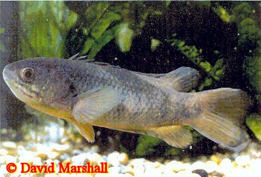

Scientific Name -(new change in scientific names) Anabas testudineus and Anabas oligolepis the later is the most common aquarium species

<!--more-->

Scientific Confusion? - With several slight colour and morphological differences in Climbing Perch found throughout their natural range it may well be that, in future, we will see some of these given alternative scientific names.

Natural Range - Thailand, Sri Lanka, Malaysia, Taiwan, Indonesia, Southern China, Vietnam, Cambodia, Philippines.

Size - 10" (25cm).

Danger? - The gill covers are equipped with various spines used as a defensive mechanism and are said to cause pain (if my experience of badly swollen fingers and large blisters caused by the ventral fins of Synodontis species 'Nigeria' is similar to this then such contact is best avoided and only plunging my hand into extremely hot water took this swelling down) if they catch a human hand.

Fin Movers? - These fish are capable of moving from pool to pool by using their pectoral fins, caudal peduncle and gill covers as a means of locomotion. As a means of protection these fish are said to use the cover of darkness in order to move around doing so in-groups and not as individuals.

Origin Of Common Name? - Climbing Perch came about due to a 'myth'. Because certain individuals are said to have been found in tree tops a 'myth' spread that these fish were capable of shinning up tree trunks with ease but science would prove that fish eating birds actually dropped or left catches of this particular fish on tree branches.

Aquarium Conditions - In his Tetra published book Labyrinth Fish - The Bubble-Nest-Builders Anabantid expert Horst Linke recommends that these fish be maintained in aquaria of 70x40x40cm with a temperature of between 20 and 25 C. Linke recommends keeping these fish in a well-planted aquarium. Mr. Kevin Webb feeds these fish upon maggots and large commercial fish food pellets. These fish have a predatory nature so are NOT for the community aquarium. The two Climbing Perch I care for live fairly peacefully alongside large Loricarins, Synodontis pardalis, Sajica Cichlids, Doradids and a Garra species.

Please remember that these are labyrinth fish so leave a gap between the water surface and condensation shield (in order to keep the labyrinth organ working properly) and watch for signs of velvet disease.

Breeding - Sexes told apart by girth, as that of the female is larger (particularly when in spawning condition). Males may be darker in colour and have more of a knife-edged anal fin than females. Use a large aquarium with plenty of floating plants. These fish do not build nests spawning in open water. Unlike their Gourami relatives they do not entwine in a full embrace. Spawning is said to be a very vigorous affair.

Eggs are clear in appearance and rise to the water surface. Once spawning is complete remove the adults, as they are prone to eating their eggs. Any fry which hatch (said to be from day 3 onwards) would be very delicate and require either green water or egg yolk paste as a first food with newly hatched brine shrimp to follow after the first week or so. The fry would be tiny and prone to velvet disease.

*Photograph by (and copyright of ) David Armitage*

*Our THANKS go to Klaus De Leuw, a keen aquarist who lives in Cologne, who, via the Petfrd Forums, sent us the important information that while Anabas testudineus remains a valid scientific name that Aoligolepis no longer retains this status with Anabas cobojious the accepted 'new name' for the oligolepisis species.*

### References

Labyrinth Fish - The Bubble-Nest-Builders by Horst Linke, Tetra Press.

Labyrinth Fish by Helmut Pinter, Barron's Publishing.

Star Animals Series - See & Discover Fish (English edition) - Elsa editions.

Dr. Axelrod's Mini-Atlas, TFH Publications.
