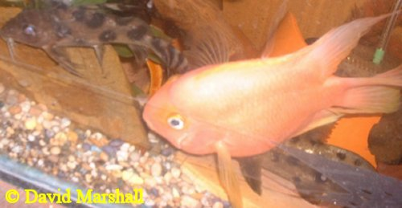
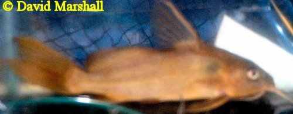

*Synodontis Decorus and Red Parrot Cichlid*

*Synodontis Bastiani*

*Synodontis bastiani*

Scientific name - Synodontis bastiani. In textbooks you are more likely to find this fish under its junior synonym name of Synodontis euberneensis.

<!--more-->

Common name - Ivory Synodontis.

Natural distribution - Ghana and the Ivory Coast.

Size - 20cm.

Body characteristics - The background colour of juveniles varies greatly from an ivory colour to plain brown to lime green. Some populations have a foreground of light spots. As maturity is reached the body sports a beautiful rich golden colour with the thick edges of the pectoral fins and dorsal fin a deep yellow.

The gills are frilled and to the left of this area is a large dark spot. The adipose fin is extremely thick. In juveniles the first ray of the dorsal stands erect like a blade but this distinction is lost as maturity is reached. The caudal is deeply forked and maturity is signalled when the upper lobe starts to extend its growth before forming a sickle-like extension that extends to a stage where it is almost touching the lower lobe.

This fish is built for speed. At the adult stage the body thickens and begins to arch.

Delicate eyes -The eyes of this species can reflect light like those of a cat. Compared to many fellow Synodontis the eyes of this specie appear very primitive and, at a distance, often look to have a thin skin membrane covering them. Anabas and Clarias deploy similar kinds of eye defence for crawling overland so wonder if

Synodontis bastiani has such qualities? Something I do know, from the experience of fellow aquarists', is that the eyes of this specie suffer in Rift Valley set-ups, for which they are often sold, as either the hard water conditions or presence of salt turns the eyes very cloudy and once this damage is done cannot be repaired.

### Aquarium care

If purchasing a young Synodontis bastiani find a full bodied fish as emaciated youngsters never regain the habit to feed. Youngsters like to hideaway among the décor emerging into the open, in hyperactive bursts, that will see them 'spook' and bully small tank companions.

At all stages of their lives these fish will fend for themselves and will feud not only with each other but with fellow Synodontis species. There are times when their aggression will know no bounds. The mature trio in my care have a strict 'pecking order'. They live in a 60x12x10" aquarium in the company of Synodontis decorus,

S. schoutedeni, S. njassae, large Plecostomus, Raphael catfish, large Botia species and a group of Red Parrot Cichlids. I would not trust them with smaller fish species.

The pH of their aquarium is 7 and has a high temperature of 79 F. Substrate of fine gravel. Decor of rounded pebbles, ceramic caves and mopani wood. . Rough territories are formed. The skin of S. bastiani is not as tough as that of many other Synodontis so avoid using sharp edged rocks etc. in your aquarium. As long as regular water changes are made filtration can be minimal. Large sized flake foods, catfish pellets, prawns and pieces of Thai crabstick are taken with great gusto.

Please remember that the pectoral spines of S. bastiani are extremely sharp so we never use a net to catch this fish but lower the water level and shepherd into a plastic bowl. When removed from the water many species of Synodontis make squeaking noises but have never heard such a sound coming from bastiani. I would not be at all surprised if this specie would bite as a last defence.

Breeding - Occurs during the West African rainy season when large tracts of grassland become flooded. Scientific research indicates that distinct pairing takes place. Dark coloured eggs are scattered in open water and over the substrate. There is no parental care of these eggs. As the eggs hatch the fry feed upon abundant micro-organisms so that they grow quickly and put on enough body fat that will enable a high number to survive when the dry season begins and the waters thus recede back to their normal river courses.

Synodontis bastiani has only found its way into the U.K. aquarium hobby since the autumn of 2003 so, as yet, there are no aquaria breeding reports
