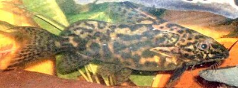

Just over two years ago, while looking through the stock tanks at Frisby Aquatics in Hull, I came across a tiny Synodontis offered for sale under the 'species' tag. At first glance the resemblance of bodily features and colour pattern to those of Synodontis schoutedeni indicated that here we had a colour variant of this well known Congo species. Going back for a second look convinced me that the dorsal pattern was a little different so as a 'Synodontis nut' I made the purchase in the hope that I would have what would be, to me, a 'new species' to study?

<!--more-->

Upon arriving home I placed the little beauty into a 36x12x12" aquarium in the company of Jade-eyed cichlids, Plecostomus, Anabas and various Doradids. This aquarium has a pH of 7 and a temperature of 24 C. The little Synodontis disappeared into the shelter of a ceramic plant pot, which he diligently defended, and would only be seen at feeding time when quick dashes from cover were made in order to grab flake and sinking pellets.

It would take 12 months, and much growth, for this fish to gain the confidence of coming out into the open and what a transformation! By now the body was stockier built and more rounded on top than that of schoutedeni.

The body colours change with mood and light but most often are seen as a dark brown-black background with turquoise-brown markings on the foreground. These markings, which run into the thickly set adipose, resemble fluffy clouds and oxbow lakes. As these fish grow so the belly region brightens with brown-yellow colouration coming to the fore.

At this stage a thick white lateral line was clearly visible but now this has become covered by black-brown skin. The head has a shield very much like that of

Synodontis nigrita. The first ray of the dorsal was thickened but it was not until I was able to take some vague digital photographs that a proper view of the fins could be gained.

From the patterns already mentioned my thoughts, backed-up by textbook and internet information, had turned to Synodontis albolineatus as the identity of this lovely fish. Now the photographs finally convinced me that this was the case. The first fused rays of the dorsal are so thick that they resemble bone. In these dorsal rays we have six broken bands of dark brown spots that, in a left to right formation, number 5,5,4,3,3,2.

Similar peacock patterning occurs in the remaining fins.

So what do we know of Synodontis albolineatus?

This fish, which reaches a total length of 95mm, is small by Synodontis standards. It is endemic to the Madjinga River system of the Djova region of Gabon. When this fish was first discovered the alcohol-based preservative changed the colour pattern of the type specimen to such a degree ichthyologists working on a possible identification believed they were looking at a second population of Synodontis batesii with only notes made by the collectors finally convincing them otherwise. When the ichthyologists cleaned the flesh from the pectoral fins they found that the remaining bone had a shape that resembled that of a seahorse. The holotype specimen resides in the Musee National d' Histoire Naturelle de Paris.

Due to the foreground body colours aquarists' in the U.K. gave this fish the common names of Mustard catfish, Mustard Synodontis and Mustard squeaker (due to the fact that these fish squeak when removed from the water).

From my own observations this fish is much less volatile in nature than Synodontis schoutedeni although it will look after itself and defend a territory. Potential enemies receive small nips for their trouble. My albolineatus grew to full body length in under two years.

As far as breeding is concerned no information has come to light. I suspect that pairs will spawn in the flooded grasses that occur during the rainy season as the Majinga's banks are broken and flood neighbouring forest areas. At this time there are micro-organisms and insect larvae in abundance for the fry to gorge upon. The resulting youngsters grow very quickly so that they are strong enough to survive in river channels as the flood recedes.

The Mustard catfish is a beautiful fish well worth the searching of aquatic retail outlets to find.
