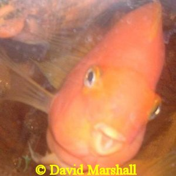
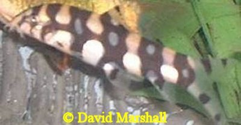
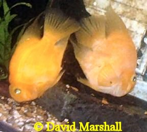
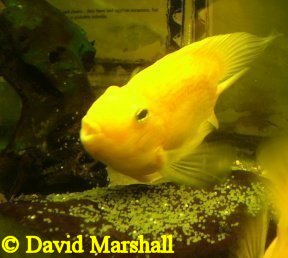

David wrote the following article for 'Cichlidae' magazine, the quarterly Journal of the British Cichlid Association. Given the subject matter - which revolves around a hybrid cichlid specie - both David and Cichlidae Editor Mary Bailey 'courted controversy' when this article first appeared in the September 2005 (Vol. 26, No 5) edition.

<!--more-->

To obtain further details about the British Cichlid Association readers are welcome to visit the official web-site at:-

http:www.britishcichlid.com

Cichlidae Editors Notes (EN) by Mary Bailey

David thanks Jackie Goulder, who retains the copyright, for permission to use the photograph of a female Red parrot cichlid guarding her eggs.

All other photographs by David Marshall

Asian parrot cichlids, which first made their way into the U.K. via Taiwanese fish exporters during the latter part of the 1980's, have no scientific name as they were not created through evolution's hand but through the cichlid crossing expertise of Far Eastern aquarium-fish breeders. For this reason they have caused more controversy in our hobby than any other cichlid that I can remember in 30 years of fishkeeping On a basic level you either love, loathe or feel obliged to show a 'fish purist' dislike towards these hybridised fish.

*The smiling face of a Red parrot cichlid*

It was the mystery that surrounds their make-up - as the original Asian producers have always refused to clarify their crossing techniques - which first drew me into keeping Asian parrots. When these fish first appeared hobbyists thoughts went as far as suggesting a goldfish x cichlid cross had created the Asian parrots but now it is generally accepted that much of their 'blood', in particular that of Red parrots, comes to us through a severum x red devil (see EN 1) line that is then further manipulated and crossed, with unknown South American cichlid species, to create ever increasing 'hellebruni' (see EN 2) patterns onto the bodies of newer varieties. Convicts (Cryptoheros nigrofasciatus) appear to have played a part also helping to create the Fire Pink varieties (probably why they produce the most viable fry).

To describe an Asian parrot is not an easy thing to attempt so we will say that the non-pink varieties are rounded in appearance, have dorsal and ventral fins which swing back towards the caudal peduncle, a fanned caudal and beautiful bright eyes crowned by a dark black pupil. The mouth, which cannot close, is shaped like a beak and this is where the Parrot tag originates from. The pink varieties have more of a natural appearance.

When the first Asian parrot cichlids appeared in U.K. retail outlets it was not uncommon to see these fish suffering from swimbladder problems but, thankfully, this seems to be an area that continued production has actually strengthened. So too has the availability of the colour variants so along with the Red and Fire Pinks we now see Forest Green, Sky Blue and Tangerine parrots among a host of others - but beware as a number of these variants are colour fed thus only retain their brightness for several weeks/months after purchase (see EN 3).

Over the past 15 years I have seen Asian parrots kept in a variety of aquaria and with a variety of companions. I have heard of individuals who will tolerate the company of fish as small as the neon tetra (Paracheirodon innesi) and others who have devoured every tiny fish in sight so, as with we humans, character appears to vary greatly amongst individuals of all colour variations.

The 5 adult Red parrots in my care have now been with me for over 4 years,

and I have a tangerine coloured youngster growing along with some young Tilapia (who thinks he is a Tilapia himself) waiting to join them, and they live in a 60x10x10" aquarium in the company of various Synodontis and Botinae species. Although there are 'squabbles' between the 5 Parrots they have never vented their anger on either each other or their companions

*This beautiful Botia histronica*

lives with David's Red parrots.

Although a number of ceramic caves are provided the Parrots prefer to be out in the open - as they are frightened that they miss what is going on in their own home and the surrounding aquaria. As I was told to maintain these fish at a high temperature the heating is set at 78 F. Filtration is not excessive and backed-up by regular water changes. My parrots are 'food machines' taking flaked food, catfish pellets, floating pellets, prawns and pieces of Thai crabstick with great gusto.

Although all cichlid keepers say 'My fish are so intelligent when compared to the average guppy or barb' I have, personally, never come across any cichlids with the level of intelligence that these parrots have. They know when the fish house door is opening and are soon 'begging' to be fed. When a 'stranger' approaches their aquarium they literally dive for cover. Every new ornament is inspected. 'Over the road' they can see a tank which houses a selection of lively barbs and the 5 Parrots go face-on to watch the activity of these fish and as the barbs move the Parrots, in unison, move their heads like a human watching a tennis ball go from one end of the court to the other never taking their eyes away from the action.

If the parrots are 'not themselves' then I know that something is wrong in their aquarium. On two occasions they refused to eat for several days and just 'sulked'. I thought that something was wrong with the water etc. in their aquarium but what they knew, and I did not suspect, was that two extremely old catfish were 'on their last legs' and as soon as these fish, to my dismay, passed away the parrots returned to normality as though nothing was wrong.

So what has the variety of available parrots, their ease of keeping and their loveable ways led to? A situation where, like it or not, they are one of the biggest selling cichlids in the U.K. aquarium fish hobby.

*A pair of Red parrots prepare to spawn*

The ovipositor of the female is clearly visible

A female Red parrot cichlid

guards a clutch of eggs.

The first time I came across Red parrots spawning was in the Tropical House at Twycross Zoo, where a pair had dug a huge spawning pit in the gravel. The pair at Flamingo Land Zoo spawn directly onto rock or pieces of slate and usually hide their activities from human sight. Jackie, the Flamingo Land aquarist, has found that the pair spawn on a regular basis but have yet to produce viable fry.

As with the traditional method of pairing cichlids most success comes through obtaining several youngsters, allowing these to mature and then picking-out pairs as they form. Males tend to have thicker areas of growth around their shoulders and, when courting, will show increased black markings upon their bodies. Females (as seen in the photographs) have a distinct ovipositor when spawning time approaches.

As mentioned earlier the Pink Fire varieties are the most easily spawned Asian parrots. Parents will guard their young. The pink fry are easily fed upon brine shrimps and crumbled flake food. On several occasions I have been shown the fry of Red Parrots but these are usually very distinct from their parents (who, in most cases, will maintain their red-orange colouration without the need for specialist colour foods) reverting back to wild colours of dull green and grey.

Finally, as I think you will have guessed, I have a great love for Asian parrot cichlids and am never afraid to voice my opinion that these particular fish deserve a place in our hobby.

FOOTNOTE - In the autumn of 2005 several U.K. aquatic retailers were offered 'Bleeding heart parrots' in which the white body has a deep red heart mark upon it (identical to Bleeding heart Platies). According to 'reliable sources' these fish have no caudal fin (tail) but are still able to retain full balance.

### EN 1

Heros efasciatus x Amphilophus labiatus, though the overall shape suggests that maybe A. citrinellus, which also occurs in red-orange forms, may actually be the species involved.

### EN 2

'Chocolate cichlids'. The former Cichlasoma hellabrunni is now regarded as a synonym of Hypselecara temporalis.

### EN 3

These are thought to be created not by genetic or dietary means, but using dyes or other biochemical methods. Naturally orange fishes can be colour-enhanced using carotenoids, but I am not aware of any food that can actually create orange/red let alone green, blue and purple.

THANKS MARY
