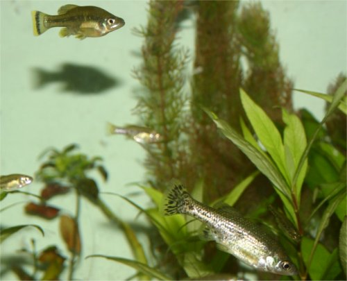

*Photograph by David Marshall*

Generally speaking, the group of fish we know as Live Bearing Tooth Carps have always been easily identified by the fact that males do not have an anal fin, instead this part of their anatomy is modified to form what is correctly known as the Gonopodium. However in the mid 1970's another family of livebearers was discovered in Central America and more particularly Mexico in which both sexes had an anal fin, albeit the first two rays of which in males were much shorter and formed what some biologists call the Andropodium, whilst others refer to it as the Spermatopodium.

<!--more-->

This family is collectively known as the Goodeidae, of which there are perhaps upwards of 50 species, one such member being Ameca splendens (Butterfly Goodeid) - an attractive and very brightly coloured fish which sadly, because of its size, would not, in my opinion, make an ideal community tank inmate, not because of any aggressive nature, for I have found it quite peaceful in that respect, but at a mature size of 8 to 12cms (that's almost 5 inches in old money) its boisterous and hyperactive behaviour could be rather intimidating to its smaller cousins. In all other respects it would be a good fish or the novice aquarist, being quite hardy and tolerant of most tap water. It seems to prefer a vegetable diet and is a great browser on algae, which is easily cultivated by strong light. Good filtration will prove beneficial.

The fish are ready breeders, but the number of fry will be small, perhaps only one or two and never more than 25-30. Compared with other livebearers this may seem very few, but when each fry is almost 2cms long at birth one begins to realise that even 20 is an almost impossible number. Little wonder the female appears quite hollow bellied after the event.

Sexing fry in the early stages is not the easiest undertaking until such times as the observer's eye becomes practiced at discerning the minute extra lobe like appendage on the anal fin of males. As the fry mature so the task eases. Once sexual maturity has been reached then there are no problems in sorting males from females. Whilst the body colour patterns remain similar with multi-speckled glittering dots of olive, yellow, silver and black. The black dots become more numerous along the centre of the body, creating what appears to be a solid lateral line, but on closer inspection it is seen not to be the case. However the caudal fin of the male does have two vertical bands of colour, the inner being black and the outer yellow. The female caudal fin remains clear.

As mentioned earlier, most of the Goodeid species originate from Central America and Mexico. Ameca splendens is found throughout this area and ironically one of its main locations is the Rio Ameca (Rio meaning river). I think I am right in saying that this is the only instance where a fish's location has been used to form its generic name. There are of course a great many examples of the specie name being a derivation of its site of discovery i.e. amazonensis, brasiliensis or cameronensis etc. (from the Amazon, Brazil or Cameroon). The specie name in this case being splendens which translates as bright or glittering.

My first experiences with Ameca splendens was around the mid 1980's. Sadly I don't appear to have kept a complete record of when and where I obtained them. My card index system only refers to the fact that one pair of Ameca splendens along with one pair of Xenotaca eiseni had been purchased. Perhaps it was my intention to fill in the details later, and it got put off and put off until it was overlooked completely.

Thankfully I can be more precise about my current specimens. On 18th May 2005 my 'old friend' David Marshall called to see me bearing a jar of six Ameca splendens (one semi-mature pair and four immature fry). It was nice to be reunited with this specie again. The fish settled quickly and, to my amazement, began to consume the duckweed which completely covered the water surface. After four months not one piece remained which resulted in me having to replenish supplies from other tanks.

I don't know whether the additional diet of duckweed has been responsible in any way for conditioning my fish, but offspring have been produced at frequent intervals, for example, 11th July 11 fry, 25 September 5 fry and, more recently, 7th October 18 fry. In each case the fry were born under the cover of darkness. Could this be nature's way of protecting the fry from predation by other species? Unlike most other livebearers, the parents do not have predatory tendencies towards their own young; for one thing the newly hatched fry are too large to be swallowed by them anyway.

Finally recent environmental tragedies in Mexico have made me contemplate what may have happened to colonies of river fish, such as Ameca splendens, which have been washed out of their environment to end up who knows where? Disasters of such magnitude and unnerving frequency make one realise just how fragile the ecology is and that the aftermath of such conditions may well be responsible for causing the extinction inn the wild of species endemic to this region
