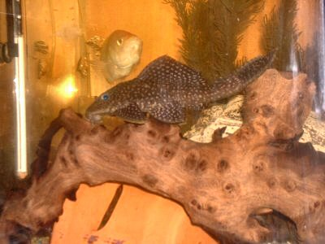

*Photographs by David Marshall*

Along with pieces of coal, sadly 'out of fashion' as an aquarium decoration, bogwood is one of the oldest known items of aquarium décor. Amazingly no two pieces of bogwood look alike and the brown-black colouration of this particular wood can really make dark green aquarium plants stand out against its various textures. Perhaps the main drawback with bogwood is that, particularly in the short term, it leeches tannin into the aquarium water and the only way to stop this is through a curing process.

<!--more-->

Several weeks ago 'Mark', a Texas-based aquarist, got in touch with me, after reading Majid's Ryedale Reporter bogwood article on the Aquarticles web-site, to ask if I would obtain for him further information on what was the best bogwood curing process to try? As Majid was away on holiday at the time I contacted Gerry for advice. Gerry was thrilled to be asked to help and I e-mailed the following information to Mark the very same evening:-

Hey Mark

Hope you are keeping well.

Today I was speaking with my friend, and much-respected aquarist, Mr. Gerry Hawksby. As promised I asked Gerry about the varnishing of bogwood and here is a point summary of Gerry's advice:-

1\. Unless you have to varnish the wood don't, as there is not a 100% safe method. Leave the piece of wood to soak in a bucket of water for several weeks and this should greatly reduce the tannin before the wood is added to your aquarium.

2\. If you feel the need to varnish then you may be able to use a polyurethane varnish but even those deemed 'fish safe' by your local hardware or DIY shopkeeper may not be so and you risk losing your 'finned friends'.

3\. The safest way to varnish is actually through the 'old fashioned' method. This does not guarantee 100% success but should seal the wood to a degree that visibly reduces the leeching of tanning:-

Find a bucket or other suitable container that is large enough to hold the piece

of bogwood. Now fill the bucket with a solution that is composed of 95%

water and 5% vinegar. Leave the bogwood in the solution for a week. The

vinegar will then start to seal the wood.

After a week remove the bogwood and rinse the bucket thoroughly before

re-filling with water only and leaving the wood to soak for a further week.

Further thought on this subject concerns the fact that a number of loricarins need the enzymes found in bogwood in order to maintain their digestive system in working order while certain cyprinids and livebearers, in particular Russian Cobra Guppies,

will pick away at small particles of bogwood for some unknown reason so maybe by curing bogwood we are actually doing great harm to certain aquarium residents?

*I find Mopani wood to be less 'messy' and the tannin content leeches for only a fraction of the time than is the case with bogwood.*

### KEY TO THE PHOTOGRAPHS

Magnum Plec. - Many loricarins, like the Magnum Plec. featured on our photograph, require the enzymes found in bogwood in order to aid their digestive processes.

Plec. - L001 grazing on Mopani wood.
