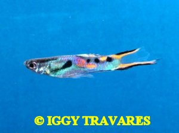
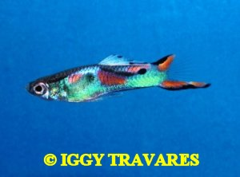

Mr. Gerry Hawksby is a much respected Yorkshire aquarist, and Honorary Member of Ryedale A.S., who recently accepted the honour of writing the opening page for the new Y.A.A.S. web-site.

<!--more-->

*Mr. Gerry Hawksby at home among 'all things aquatic'.*

*Photographs by David Marshall*

On a recent visit to my home, David Marshall asked if I would write an article for his Ryedale Reporter (the monthly magazine of the Ryedale Aquarist Society) on my experiences with the 'Endlers' (Englers) livebearer. I suppose David's request was understandable as I had not kept them previously and it was he who provided me with my initial stock. I could tell that David was interested to record my thoughts on and experiences with these particular fish so hope the following will suffice.

I have to admit to knowing very little about this specie beforehand as I had never seen them for sale in any aquatic retail outlet or found any reference to them in any of my textbooks so assumed that, more than likely, they were either a newly discovered specie with any published material yet to catch up with the publishing community or some form of Double Tailed Guppy hybrid. David assured me that the latter was not the case as this fish was a specie in its own right and one that bred true to type. That been so the hybrid theory could be disregarded.

Any lingering doubts I had were dispersed when I subsequently read a very informative article on this fish, entitled 'Three Unusual Livebearers', which was written by Mr. Howard Norfolk for the Aquarticles web-site (which you can find on the links page of the Ryedale A.S. web-site) and then downloaded by David for use in the January 2003 issue of Ryedale Reporter. I now had all the background history of this colourful little gem.

Howard's article informed readers that Poecilia sp. 'Endlers' was first collected in 1937. That being so why hadn't any reference to its existence been included in any textbooks or magazine I had in my possession and why had it taken a lifetime before it appeared locally? Maybe it had been looked upon as being one of the poorer examples of the known populations of the Guppy as I suggested earlier and, as such, a fish which would be overlooked by most fishkeepers visiting their local dealer. If we reach a situation where there is no demand for any specie then dealers will not stock the specie in question thus the average aquarist will not be aware of its existence. It is the stalwarts, and species specialists, of our hobby who keep the lesser-fancied species going.

So what of my experiences? During the several years I have now kept this specie, I have found them to be one of the most undemanding aquarium fish ever to grace my tanks. They appear happy in the more usual aquarium conditions i.e. gravel base, plants either plastic or live and normal tap water with simple filtration. Because of their size they should only be kept with smaller growing species otherwise their larger cousins will look upon them as a quick snack. Under no circumstances should they be mixed with Guppies or any other Poecilia species otherwise they will interbreed thus the true specie will be lost.

Personally I've found them sufficiently rewarding as to warrant a tank of their own. From my original three pairs I have gone on to fill 2 two feet and 1 three feet tanks with these charming little ovoviviparous fish, they are so prolific.

A male Endlers displaying to a female.

Obviously not all fishkeepers have the space or desire to accommodate such numbers of fish, but any surplus can easily be disposed of amongst society members or sold at open show auctions. Most of the aquatic retailers I have come in contact with have been willing to come to some 'swap' arrangement as homebred fish are often much sought after.

An interesting feature appeared in one brood of fry when I noticed that 3 males stood out from the rest as they developed. Instead of them sporting the usual black spot, centrally placed on each side of the body, these spots virtually became a black lateral line extending into the caudal peduncle. I was in two minds as whether I should segregate these males or not. Two factors presented themselves:

1\. Was I already too late for perhaps one or more of these males had already impregnated some of the females?

2\. Could the females from the brood be carrying the genes for the anomaly, which would show through in future offspring? I would, therefore, have to attempt the impossible by isolating the whole brood. This presented me with another problem - I did not have a suitably sized tank in which to house 30 or so young fish.

In the end I did nothing and to my surprise, and I suppose relief, none of the subsequent offspring have shown these characteristics which prompts me to suspect that the genes which prompted the abnormality were in fact recessive.

I can truly say that my experiences with this particular specie have been productive and, more importantly, most interesting.

Finally, I have heard this fish referred to as the 'Endless' livebearer by some aquarists' who obviously misheard the common pronunciation. In one respect they are absolutely correct for mature females will produce substantial broods of fry at regular intervals, in all other respects they couldn't be further from the truth as they do sport a colourful and attractive caudal formation.

In late March 2007 David Marshall gave a small colony of Endlers Livebearers to his friend and renowned aquatic photographer Mr. Iggy Travares. Iggy sent to David five beautiful portraits, three males and two females which we have the great pleasure of presenting as follows.

