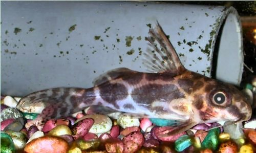
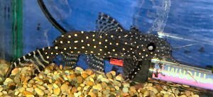
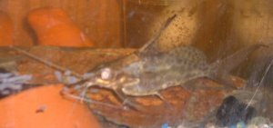

*Photographs of Synodontis robertsi and angelicus by Kevin Webb*

*Photograph of Synodontis alberti by David Marshall*

In our 'hobby' Synodontis robertsi is usually sold under its scientific name as opposed to the common names of Robert's Synodontis and Large blotch Synodontis. In the wild this fish hails from Central Congo, Lukeria and the Egobe river system.

<!--more-->

*Synodontis robertsi*

Synodontis robertsi is a member of the Mochokidae family. The Mochokidae lack the protection of body scutes (which you will know through Corydoras) so nature compensated by the provision of a continuous bony shield that runs from behind the eye to the dorsal fin spine that deflects all but the hardest blows from the teeth and bills of aquatic living mammals and fishing birds respectively.

Although I have heard no reports of a robertsi squeaking (backed-up by the fact that squeaker does not appear in the common names quoted above) when removed from water this is a secondary defence system among the majority of Synodontis species.

As with all Synodontis the pectoral fin spines are a 'wonder of nature'. Very sharp they also afford protection (watch your fingers) while recording growth like the rings of a tree. The pectoral fin bone of each Synodontis species is different so becomes a 'signature tune' allowing ichthyologists, once the flesh is removed, to tell the true identity of species which may look alike to the naked eye.

A fact file on the Planet Catfish web-site describes the body pattern of our subject specie as 'giraffe-like' and although I go along with this the pattern of dark brown and white varies greatly among individuals (as readers who know the more commonly seen Synodontis angelicus will be familiar) going from crop circle markings to bars as in Synodontis brichardi. The body, which can reach a maximum size of 16cm, has a raised appearance like that of Synodontis contractus - with whom large 'alberti eyes' are also shared.

*Synodontis angelicus*

Considering the likeness to Synodontis contractus, which has plainer and bland body colours in comparison, there is little wonder that one can be offered for sale as the other. The body colours of Synodontis caudalis (forked caudal lacking in robertsi) and certain colour variants of Synodontis schoutedeni (smaller eyes and more yellow colour in body) also lead to these two species occasionally offered for sale as robertsi.

To see both the likenesses and differences between the mentioned species visit the fact files and photographic galleries on both the Scotcat and Planet Catfish web-sites.

Before moving onto aquarium care we must note that our subject specie can be very delicate and one which, despite great care, sometimes never settles into aquarium life literally dwindling away. This is often signalled by the onset of lethargic activity, at which time the robertsi will sit close to the front of the aquarium and find a spot from which the only movement will be tiny rocking motions.

The roots of such demise are often:-

1\. A failure to feed. Robertsi can go on 'hunger strike' following exportation, which also occurs with certain 'L' numbered loricarins, and once out of the eating habit may never resume this vital practice. If you are on good terms with your local retailer always ask to see a robertsi feed prior to purchase.

2\. The shock of 'new water'. Because of their delicate nature robertsi need to be placed into a well established aquarium, with excellent filtration, in which only minimum water changes are made.

Aquarium care begins with a minimum sized aquarium of 60x30x30cm. The aquarium should be well filtered with a pH between 6.2 and 7.5 and temperature in the range of 23 to 27 C. For décor well plant the aquarium and provide shelter in the form of Mopani wood, broken plant pots (which should have smooth edges as the skin of robertsi is softer than it first appears) and small ceramic pipes. Medium-sized African characins make good companions. As robertsi are a Riverine species they should not be kept alongside Rift Valley cichlids. When eating they will take small living foods and commercial flakes.

Taking the contractus and alberti (Albert's catfish) likenesses very seriously it may well be that, like these two species, robertsi does not have the long natural lifespan, sometimes in excess of 20 years, that is enjoyed by a number of Synodontis including the well known decorus (Clown squeaker) and eupterus (Feather-finned catfish).

*Synodontis Alberti*

Sadly there are, as yet, no reports of robertsi reproducing within the confines of aquaria. Field reports suggest that distinct pairs form, during the Congo rainy season, and that, in open water, dark coloured eggs are scattered over the available substrate.

As a final point we must mention that Synodontis robertsi are not always readily available so their price in aquatic retail outlets can be very high - in some cases topping that asked for Synodontis angelicus.
