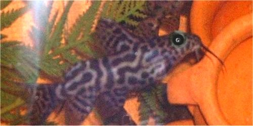
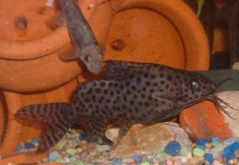

*Text and photograph by David Marshall*

As our subject specie did not come about through the trials and tribulations of natural selection, but as the direct result of hybridisation techniques employed by Eastern European fish breeders, Synodontis 'species' black pebble will become the first non-affiliated member, as (unless there is the same mistake which may have given a hybrid specie validity as Synodontis galinae) it will never receive the accolade associated with scientific naming, of the Mochokidae family we have discussed.

<!--more-->

Synodontis 'sp' black pebble was first seen in the U.K. during the summer of 2004. How long it will remain available is questionable as some hybrid Synodontis, e.g. the cross thought to be between Synodontis pardalis 'aquarium variant' and S. multipunctatus the Aqualog people labelled 'hybride?' ('super new black spot'), remained obtainable for long periods whereas others, e.g. the 'sport' of Synodontis ocellifer sold as 'sp' ice, seem to arrive here as 'one off' shipments.

What we have with 'sp' black pebble is a wonderfully patterned fish whose black body markings, set against a grey background, are a real mixed bunch of shapes and sizes that form a pebble, and a quite psychedelic, effect. The human creators have kept the species crossed to form this effect, a closely guarded secret but as there are many similarities, in particular the body shape of youngsters and the fin and body colours of adults, to Synodontis aterimus (Bokuma syno catfish), and seeing how a number of catfish enthusiasts already believe that aterimus forms part of the make-up of Synodontis serpentis 'aquarium variant'(which looks very different from photographs of the 'wild form), it is a likely bet that this fish was used somewhere down the line?

*Synodontis Black Pebble*

So could aterimus and serpentis 'aquarium variant' have been crossed to form this 'new fish'? Probably but both are less stocky in build and more arched in appearance than my sub-adult black pebble has become. As you will see from the accompanying photograph the dorsal of black pebble has thickened first rays and is highly raised with a sickle extension to the top lobe of the caudal.

This had me wondering if Synodontis eupterus (Featherfin catfish), commonly bred in both Eastern Europe and the Far East, could account for both the build and dorsal as a second possible species component but, unless there is a gene restraint, this probably led me down a false trail as the skin covering the dorsal rays of black pebble is solidly set, and lacks filaments, whereas that of eupterus always appears to have been stretched over these rays like the body of a kite over its framework.

*Feather fin and Goyotola*

Of a stronger dorsal framework, and with the same extension to the caudal, we have Synodontis nigrita (in particular those seen as Synodontis 'sp.' Zaire), again widely bred in Eastern Europe and often seen in the U.K. as a stunted version, and the spotted pattern of this fish against a black background could account for some of the dark colour seen in black pebble?

Sadly we may never know the true make-up so all we can do is just enjoy this particular fish for its shear beauty and as Synodontis aterimus reaches an average size of 10cm we will make this our guide for black pebble - in 15 months my fish has grown from 3 to roughly 9cm.

My black pebble is at home in a 90x30x30cm aquarium that has a pH7 and a temperature of 28 C. The aquarium is well planted and has many cave structures but 'he' is rarely found in any of these and likes to hide in the shadows. Flaked food, Thai crabstick, catfish pellets and pieces of prawn are all taken with great gusto. Various Synodontis species, a large Zulu perch, Tilapia, a Polypterus and a large Sucking loach share 'his' home and very little problems between the occupants are seen to occur.

Although I doubt that it would be possible for a pair of black pebble to reproduce in aquaria (and have heard no reports of this happening with any of the other hybrid Synodontis that have been available in our hobby) we cannot totally discount the possibility that our hybrid, which either came about through a natural crossing(s) of two or more Synodontis species or through clever clinical manipulation of eggs and sperm (the 'hybride?'('super new black spot') could be a substrate x cuckoo spawning creation), could be fertile - remember that we were told that Asian red parrot cichlids would never reproduce naturally but a large number of such spawnings have been recorded.

Should such a spawning occur it is very likely that, as with aterimus, a pair bonding will form in which the female will scatter her eggs over the substrate with the male following quickly behind in order to fertilise as many of these eggs as he can.

In conclusion Synodontis species black pebble is a fish whose make-up we are uncertain of but one which, despite any ethical worries, is another welcome addition to the aquarium hobby.
