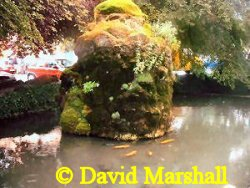
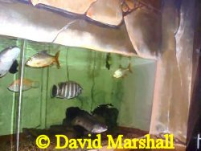
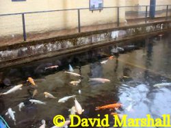

As you arrive in the Derbyshire town of Matlock Baths you get the strange feeling that you have been transported back to an early 1960's seaside resort that has somehow been transported into the heart of the Peak District.

<!--more-->

Your 'fish day' begins in the Tourist Information Centre car park as here you find a lovely pond, surrounded by trees, that is home to some beautiful Golden Rudd and various Carp species.

*The car park pond.*

The aquarium itself is situated above an amusement arcade in buildings that once formed the Matlock Bath Hydro (which dates back to 1883). With an adult entrance fee of only £1.80p you will not find greater aquatic value anywhere else in the U.K.

The 'inside display area' consists of 18 aquariums, mainly tropical freshwater, which vary greatly in size and dimensions. What all have in common is that they are well maintained and contain very healthy looking fish.

Of the smaller displays one containing a shoal of Red Line Torpedo Barbs, Danio devario, Sucking Loach, Schistura species and Red-tailed Black Shark really caught my eye. In the one tropical marine display the colours of the various Clownfish and Angels were a delight to see.

But it the larger tanks that really stick in the mind. The aquarium pictured contains three extremely large (and old) Snakeheads, Golden Tilapia, Hornet Tilapia, Hypostomus multiradiatus and has two carefully constructed 'rock piles' at either end from which Mbuna of several sizes maintain 'order' in what is like a community within a community.

*The Snakehead community tank.*

In another, but deeper, aquarium are two huge Giant Gourami who have Tinfoil Barbs, an Albino Plecostomus, Jaguar Cichlid and young Red-tailed Catfish for company. In the adjacent aquarium a Short-nosed Clown Tetra is so old that all the usual black and orange body stripes have faded into what is now a solid grey.

The only real Biotope aquarium you will find here is home to a mainly Amazon community where large Black Pacu and a Red-tailed Catfish rule. Once again a large rock pile allows for Mbuna to interact without fear of becoming 'cat food'.

Non-fish exhibits also have their share of the space with Rainbow Crabs and Terrapins on display. During our visit a Toad was 'hopping' around the floor and an assistant explained that no matter how many times this creature is removed from the building it always returns. Perhaps it is as intrigued with the fish exhibits as we human visitors are?

Now we are outside and find the thermal pool. Fed by a spring from the hillside, which moves 600,000 gallons of freshwater through the pool each day, the pool has a constant temperature of 20 C. In Victorian times patients with rheumatic and digestive problems bathed here but now a collection of 'baby whale' Mirror, Common and Koi Carp call it 'home' and what a spectacular sight they make.

*The outside pool.*

When we were first here, several years ago, you only had a small viewing area from which to view the fish but now all the walkway (which was a little slippery) around the pool is open with a fence to protect visitors from getting too close to the water. To make the fish even more 'people friendly' visitors are allowed to purchase, via vending machines, feeding pellets.

Just to add to your visit, and at no extra cost, you can also enjoy a petrifying well, gemstone and fossil collection and a hologram gallery.

The aquarium is open daily from Easter to the end of October (10.00a.m. to 5.30p.m.) and during winter weekends and the Christmas holidays (10.00a.m. to 5.00p.m.). Believe me this aquarium is well worth a visit.
