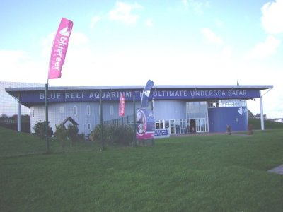
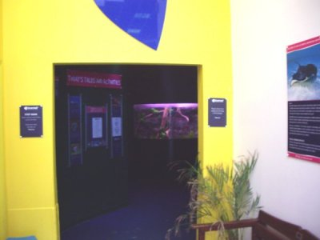
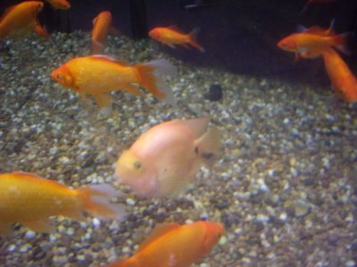
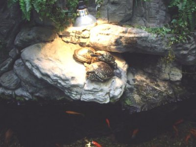
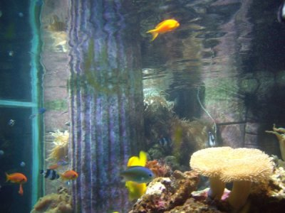
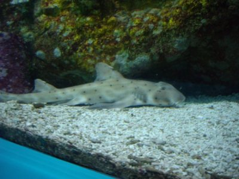

The Blue Reef Public Aquarium is situated on the Grand Parade at Tynemouth, Newcastle-upon-Tyne.

As you enter the aquarium you find yourself next to a large open topped exhibit that is home to six Terrapins, a large number of Common Goldfish and a 'surprise guest' in the form of a large Asian Red Parrot cichlid. We first viewed this exhibit when both Terrapins and Goldfish were very tiny and perhaps this is the key to why they co-exist in apparent harmony?

<!--more-->

As you enter the exhibits proper, of which there are just over 30, you are face-to-face with a large hexagonal tank that is home to a small shoal of Red-bellied Piranha. Sue and I arrived at feeding time and it was interesting to see the others stand aside to let the 'head man' take first choice of the large pieces of mussel that formed their dinner.

The only other tropical freshwater display is a beautifully aquascaped display aquarium that mixes fish from several countries that include Ancistrus (the largest adults I have ever seen), Black Neon Tetra, various Corydoras, Neon Tetra and various species of oviparous livebearers.

River Turtles occupy the fourth exhibit. The décor of tree branches, ferns and running water has been so well put together that you have to let your eyes do plenty of adjusting in order to spot the well hidden Turtles. Members of the Kinospernon genus these beautiful creatures were seized by Customs officials during a raid on a London premises.

Native marine exhibits follow and the beauty of our native Wrasse always entrances me. The Stingray display area is very interesting and consists of a long pool that is cleverly designed in order to recreate a sea floor of several levels. Now we find 'oddball' marine creatures from around the World that include fierce looking Wolf fish and dainty Seahorses.

The original Ray exhibit area has now been completely redesigned to form the habitat for a family of Asian short-clawed Otters. What a spectacle these 'stars' put on for 'their' visitors as they frolic around the décor. On the far wall a video screen shows film of marine mammal conservation programmes from around the World. The Otters can see this and each time Sea Otters appeared on the screen the little group become very excited, and vocal, as if trying to chase away potential rivals for 'their territory'.

Now we are into the tropical marine section. The coral reef display tank, which took 9 years to mature, remains the centrepiece and the Yellow Tang here are a sight to behold. Elsewhere strange looking Goat and Domino fish hold domain.

The amphibian displays are excellent. Sue loves the dainty Tree Frogs whereas the gigantic xanthic Xenopus fascinated me. Giant Cuttlefish, Shrimp and Octopus displays follow.

Now our visit takes us outside to the newly built Harbour Seal exhibit. Here four rescued Seals live in luxury. Unfortunately we missed feeding time but are reliably informed that this is the best time to view these remarkable creatures.

Back inside the visit ends with the wonder of a 'walkthrough acrylic tunnel'. Here a number of large tropical marine species swim above and around you. Panther Grouper, Lipstick Tang, Horn Shark and many more are here in all of their glory.

*In conclusion the Blue Reef is an excellent place to visit and has a broad aquatic appeal. We look forward to our next visit.*
