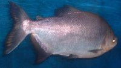
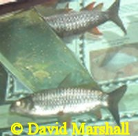
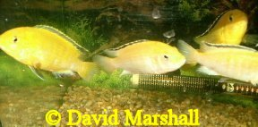

*Text and photographs by David Marshall*

*Cichlids photographed by Jackie Goulder*

Beverley Road is like the artery of the East Yorkshire City of Kingston-upon-Hull with its many branch roads leading to the main leisure, shopping and business areas. For Sue and I it is the means of finding Sculcoates Lane and this, in turn, takes us to the door of Frisby Aquatics - where a wealth of unusual and rare fish species are always to be found.

<!--more-->

For a while now Arthur (Frisby) had promised, when time allowed, to show us the aquatic delights that await in the Conservatory at Pearson Park and on a recent visit promise became reality. Pearson Park is a large open area of parkland situated very close to the City Centre. The centrepiece of the Park features two large ponds surrounded by gardens, woodland and games areas. Grey Squirrels abound.

The Conservatory is tucked-away in a corner at the bottom end of the Park and its design and whitewashed exterior reminded me of one of the Churches that you see in movies filmed on the Canada-U.S.A. border. It certainly transmits the same sense of peace and tranquillity with vines hanging from the ceiling, various ferns growing from the floor and the sound of running water all adding to the atmosphere.

The first animal exhibits come in the form of two very spacious aviaries that are home to cockatiels, budgerigars and various canary species.

The first aquatic exhibit features a small pond that is home to a number of small sized goldfish and a Plecostomus. Larger representatives now feature in a bigger sized pond. Both of these ponds are well filtered and the heat from the Conservatory means that the Plec.'s are able to live in comfort without the need of heater-thermostats.

Now we are at what is best described as a three-sided wall and into this are built 12 aquariums and 4 vivariums.

The largest aquarium is deeper and wider than it first appears and is home to a variety of very large fish that include Tilapia mariae, Red-breasted Pacu, Iridescent Shark Catfish, Lemon-finned Barbs and Leptobarbus hoevenii.

*Pacu.*

*Leptobarbus hoevenii in reflection.*

The aquariums which follow are mainly 'themed'. My favourites featured a small shoal of Schubert's Golden Barbs (Puntius sachsi) and a group of Ameca splendens of mixed age and size.

The highlight of the aquarium displays is undoubtedly the Rift Valley Cichlid community and the fish here include various colour variants of the Zebra Cichlid and several beautiful Labidochromis carruleus. Such is the breeding success within this aquarium that a number of cichlid youngsters are now housed in separate aquaria.

*Labidochromis carruleus*

Of interest was an aquarium containing a mixture of both normally coloured and white coloured Convict Cichlids. Typical of their kind all were digging in the gravel and trying to form small territories.

Over the years Arthur has formed a good friendship with the Pearson Park Keepers so we were very fortunate to be allowed to have a look at the Education Area, usually closed to the General Public, and here are a wide variety of amphibians and reptiles that have either been donated to the Park of brought along by animal welfare groups. Lovingly cared for these various creatures are used to educate children in order for them to gain an appreciation of the varied animals with which we share our World.

The Conservatory at Pearson Park is well worth a visit. Thank you Arthur for continued friendship.

Opening hours - 10.00a.m. to 4.00p.m. daily.

Admission is free.

To find by car - Follow the Beverley Road (A1033) into the outskirts of Hull. Follow signs for City Centre. Once clear of the turnings for North Sea Ferries and the University complex you will see Sainsbury's on your left-hand side. Go straight over two sets of traffic lights and, a short distance on, the entrance to Pearson Park is in a side road on your right-hand side. Follow the bend on your left and go round to the very end of the Park. Here you will find the Conservatory on your right-hand side.
