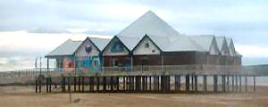
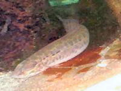
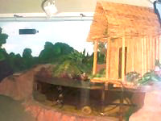
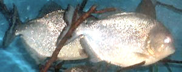

Weston-Super-Mare is the closest seaside resort to Bristol and is often described as 'Mini-Blackpool'. Unfortunately, upon the day of our visit, the heavens decided to open so we did not see much of the town and will long remember the sight of forlorn fellow visitors literally 'soaked to the bone' as the wind blew cascades of water in from the sea.

<!--more-->

When the Seaquarium, which was built by the Sea-life Company at a total cost of £1.6 million, was opened in 1995 it was hailed as a spectacular achievement and as the last aquarium (to the present time) in the U.K. to be built upon a pier (which was specially constructed for this building).

In more recent times the Sea-Life people sold the building (along with one of their properties in Wales) to Seaquarium Ltd. and a transformation thus began from displaying native marines to a more all round aquatic experience.

As you enter the building you are in the 'Evozone' in which aquaria, of various sizes, displaying African Lungfish, Axolotl, Horned Frogs, Dwarf Crocodiles and Bearded Dragons are used to show various steps along the path of evolution. I have a feeling that work is yet to be completed upon this section as there was no clear information as to how and why these species were actually chosen so visitors with little knowledge of evolutionary theory may have been a little bemused at this point?

*The local fish exhibit.*

*African Lungfish*

Now we move onto a beautiful biotope exhibit that showed 'South-West freshwater fish' where European Perch, Golden Rudd, Common Carp, Pumpkinseeds, Mirror Carp and Sterlet were used to show how the diversity of the local waterways are composed of both native and introduced fish species.

'Brackish waters' was brilliant. The main part of the biotope featured a South Seas fisherman's hut. The young Scats, Archerfish and Fingerfish were all in excellent condition and when these youngsters reach maturity this will form one very spectacular exhibit.

*Brackish Biotope*

Sixteen aquaria, varying greatly in size and dimensions, featuring various tropical marine fish species follow. What has to be said is that ALL of the fish displayed were in an excellent state of health and I liked the way that notices were posted to say 'No flash photography as this can do great harm to sensitive fish'.

My favourite display was 'Red Sea' and the fish species here included Green Wrasse, Torpedo Goby, Blue-green Chromis and Flame Angelfish. Sue was intrigued by a Mottled Stonefish who shared his home with a huge Zebra Moray Eel.

With native marines in mind the 'Ray Pool' has been retained and I am always fascinated by the natural camouflage of these most elegant of fish.

Now we are onto 'Amazone'. We found this area in great transition and containing tropical freshwater species from Asia and Africa as well as those from South America that we had expected to find.

As usual the Piranha display caused much interest among visitors. I liked the Mbuna display with its various colour forms of Zebra Cichlids. Some newly installed Silver Dollars were forming a tightly packed shoal and had a beautiful North American Gar for company.

*Piranha.*

Now here was one exhibit I could not understand? In an aquarium through which you had to look-up through small glass portholes to catch glimpses of the fish were Black Pacu's, Tiger Shovel-nosed Catfish and Red-tailed Catfish all of whom had been donated by their previous 'owners'. From what the eye could catch these fish were in an excellent condition but surely they would have been better displayed in an aquarium in which they could actually be viewed?

Now we are onto several tanks containing 'Night hunters' and although a lovely Pygmy Lionfish and a Moray Eel could be seen I found this the most disappointing section.

Finally we reach a native marine walk through tunnel complete with Dogfish, Rays and Pollack. Be warned as once you are through the spinal gate that follows you are out of the fish exhibits and into the cafeteria and gift shop area.

In conclusion the Seaquarium is well worth a visit and we had an enjoyable time here. As you will have surmised the displays are in a state of transition and once this is complete the Seaquarium will, hopefully, become a compact complete aquatic experience.
