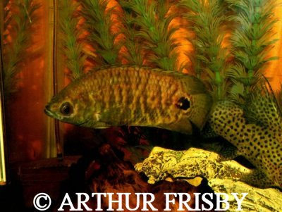

*Photograph by Arthur Frisby, Wyke Show Society*

Ctenopoma ocellatum is endemic to the Congo River system of Zaire. The first aquarium specimens arrived into Europe at a time when awe and wonder had not been overtaken by geographical correctness, so the first labyrinth fish enthusiasts to see ocellatum linked their amazing cross-striped foreground pattern, to that of the battle formation of locked together diamond-shaped shields used by the famous Zulu warriors of Southern Africa and came up with the common name of Zulu Perch.

<!--more-->

Sadly, in modern times, this common name has given way to the blander sounding Eyespot Ctenopoma (Climbing Perch) in reference to the ocellus marking at the caudal peduncle. This ocellus acts to confuse potential predators, as when the Zulu Perch breaks cover it is hard to tell, in unclean water, what is head and what is tail.

The Zulu Perch has a very leaf-like body shape (always reminding me of the ace of spades symbol), moulded by nature to blend into riverine debris, and uses this to its advantage as, using the pectoral fins as steering accessories, it will drift through the water looking like a fallen leaf before suddenly engulfing unwary prey in the shape of smaller fish species and other edible foods.

For protection against both predatory fish species and fishing birds evolution armed the Zulu Perch with an array of spines that are present on the hind margins of the gill cover (which is why the Manyspined Bushfish was scientifically named Ctenopoma multispinis) and please note that these razor sharp accessories show no respect to human fingers! As an added protection Zulu Perch tend, in the wild, to live an almost nocturnal lifestyle.

Closely related to the Asian Climbing Perch (genus Anabas) these fish also have the ability to haul their bodies overland for short distances, in order to move from one body of water to another. During my fish studies I have come across no legends relating to this activity as regards the Zulu Perch but many such legends and superstitions surround Ctenopoma multispinis. The people of Zimbabwe believing that this particular fish 'falls with the rain', basing their beliefs on the fact that it is not uncommon for specimens to be caught many kilometers from the nearest body of water in the hours following heavy periods of rainfall.

The Zulu Perch, which can grow to 15cm, requires a spacious aquarium with one of 90x30x30cm the minimum size. Remember to follow the airspace rule for labyrinth fish, leaving a space of 2.5cm between water surface and condensation shield, as deprived of the chance to gulp at atmospheric air the Zulu Perch are unable to maintain their labyrinth organ in full working order and thus effectively drown (many a Siamese Fighting Fish, Betta splendens, has been lost in aquaria due to this reason). The Zulu Perch will do well with a pH of 7.5 and a temperature of 25 C.

From both my own experiences and those of fellow labyrinth fish enthusiasts it is clear that not all Zulu Perch share the same need to seek shelter. Some will only be truly happy when provided with places of concealment, in the form of tall plants and large pieces of Mopani wood, whereas others prefer to stay in open water at all times. Thankfully, and unlike some other members of the Ctenopoma genus, the Zulu Perch does not have a reputation for doing death leaps from aquaria, although a tight fitting lid should be employed in order to prevent any such potential escape acts.

Feeding this particular specie is never a problem - in fact some, in particular females, will gorge themselves into a state of obesity if given the chance. Commercially produced aquarium flakes and pellets, pieces of Thai crabstick, prawns and diced carrot are all taken with equal gusto.

Although they will make an extra meal of any other fish small enough to fit into their mouths, the Zulu Perch can be kept alongside large Barbs (in particular Tinfoil's), Silver Dollars, Oreochromis species, large loricarins and Synodontis catfish. Once settled in such company they tend to relax any nocturnal activity and can become very outgoing. In lightly stocked aquaria this can, on occasions, cause problems as the Zulu Perch, in particular lone females, have the ability to 'take control' and when this occurs will pick out individual tank mates to nip and chase causing as much psychological as physical damage!

Please remember that all Ctenopoma can be extremely long lived, with many records existing of those which have lived in excess of 20 years, so please give thought to this before making a purchase as Zulu Perch (like Koi and Osphronemus) need to be with aquarists committed to their long term care.

What we know about the reproductive aspects of these fish is that, at maturity, males often develop small spikes on some of their scales. Females are more rounded in appearance. During spawning no bubblenest, as is the case of their Microctenopoma cousins, is in evidence and as the female releases her eggs these are fertilised by the male and float at the water surface. Sadly, although this fish is now commercially produced, we have no published accounts of a successful aquarium spawning to refer to
