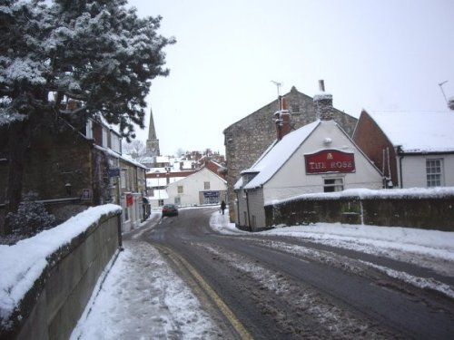
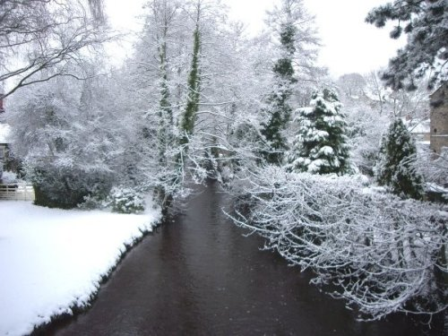

*Text and photographs by David Marshall*

The story of our very different Christmas tree began almost a year ago when I made the first enquiry about the possibility of the Ryedale Aquarist Society taking part in the St. Peter & St. Paul's Church Pickering (North Yorkshire) Christmas Tree Festival of 2007.

<!--more-->

Towards the end of October a letter arrived from the Church Project Fundraising Committee in order to confirm that we had a tree for the Festival and so our donation fee was quickly paid.

*The impressive spire of St. Peter & St. Paul's Church dominates the local skyline.*

*Enterance to St. Peter & St. Paul's Church*

From the very beginning the idea was to present a themed arrangement which would feature 25 endangered freshwater fish species from around the World in order to highlight the often unreported plight of hundreds of such fish found in a vast variety of habitats.

I took on the task of choosing the 25 fish species to be featured. The starting point was easy, as the Blue-eyed Panaque has not been reported in the wild for almost a decade now, so may well be extinct? On the other side of the coin the Two-saddled Corydoras was believed to have been extinct for a great deal longer until it was re-discovered by a Japanese expedition a couple of years ago. Next came Sandelia bainsii, as (through the A.A.G.B.) we are great supporters of the South African Sandelia fund. With our members maintaining populations of the Butterfly goodeid and the original population of Endler's livebearers we were well on our way.

A further 20 species (Bitterling, Vindace, Cherry barb, Tube-nosed goby, Sturgeon, Lamprey, Archerfish, Mississippi Paddlefish, Trout Minnow, Galaxy Rasbora, Chain botia, Rasbora wilpita, Betta uberis, Arapaima, Cichlid CH44, Singapore Betta pugnax, Cave Clarias, Aphanius killifish, Musky Pike and Silver Angelfish) were then chosen which covered all of the World's non-ice covered continents and as many of their sub-continents as possible.

The photographic collection of Mr. Howard Norfolk, bequeathed to us for Ryedale A.S. use, was a great starting point for the 25 photographs we needed, with Mr. Mark Duffil, Dr. Iggy Tavares, Mr. David Armitage and fellow A.A.G.B. members, Mr. Ivor Hilton and Mr. & Mrs. Kenworthy filling the gaps so enthusiastically.

With all the photographs in place I now prepared small information sheets on all 25 species. For each I did a common name, the scientific name, country/countries of origin, reason for decline and, where appropriate, hope for the future. Those species either classed as extinct or extinct in the wild had an extra red notice prepared in order to mark this fact.

To turn the photographs and information into ornaments required a phone call to our 'good friend' Mrs. Sue Kenworthy (Otley A.S.) who is a 'hive of creativity'. As Sue and husband Arthur were doing a presentation at the 14th November Ryedale A.S. meeting we decided that this would be a good time to prepare the prototypes. Using stencils Sue had brought along we cut out various shapes associated with Christmas from thick coloured card and while Arthur re-sized the photographs Sue, with a little help from my sister Sue and myself, set about pasting these photographs and information sheets onto the shapes.

The finished ornaments looked lovely but I knew Sue Kenworthy was not wholly satisfied. It was no surprise when, a couple of days later, Sue phoned to let me know that she had a new idea of pasting together 2 CD discs in which the photograph of the fish along with common name and, where appropriate, red notice would go on one side and the information sheet, to be edged in gilded silver, on the other. So a couple of photographs and appropriate information sheets were e-mailed to Sue and when a return e-mail showed how lovely these looked I replied 'go ahead' and Sue then took stock of the remaining photographs and information sheets and turned them into 25 wonderful ornaments.

Now just as I needed the two A4 information sheets, one about our Society and the other about our theme and the names of people to thank, our computer had problems so Sue Kenworthy came to the rescue again printing, laminating and sending these through the post.

On Thursday 6th December came Christmas Tree Festival decorating day! When 'our Sue' and I arrived for the morning decorating session, 10.00a.m. to 12noon, Mrs. Ann Grayson had already found 'our patch' and had chosen a very sturdy tree. Ann began the decorating by putting the tinsel into place and then a lovely set of Christmas tree lights (donated to us by Sue and Arthur) followed. For the placing of the ornaments it was lovely to have the help of youngsters Sarah and Molly (to whom Ann used the morning to teach the importance of community) and they did very well. No prizes for guessing that a Silver Angelfish (threatened by the clearing of fallen trees from their natural habitat) adorned the crown.

Sue and I returned for the afternoon session, 2.00p.m. to 4.00p.m,. and put the main finishing touches of placing a red Christmas cloth under the tree and fastening our two A4 notices to this cloth (for which yogurt cartons came in very handy!). The main problem facing the Organizers was the placement of all the electrical sockets needed for the lighting system. They had a qualified electrician on hand, so it was a case of shedding boots and climbing onto chairs to help. As we left one of the Committee ladies said 'Are you happy David'? and my reply was 'I am never happy as I always can do better' so Sue and I returned for the final session, 6.00p.m. to 8.00p.m., and checked that everything was okay.

The nice thing was that over all three sessions so much interest was shown in our project and as the light from the Church struck the ornaments they glistened in beauty. We were very proud both of our tree and to have taken part!

Our tree was one of 34 decorated by local hobby groups, local educational providers, local service providers and Christian groups. Spread out from the large entrance area, throughout the Church to the altar they created a beautiful display which complimented the famous Medieval wall paintings and formed a feeling of peace and humility. Well done for all the work put into the tree decorating by all concerned. It was lovely to see people of all age groups taking part during the different sessions. Now I know why Roy Wood said 'I wish it could be Christmas everyday'. The Festival ran from Saturday 8th through to Sunday 16th December.

Finally a big THANK YOU to Sue & Arthur, our photograph lenders and those who were able to give their time to help decorate a very different Christmas tree.
