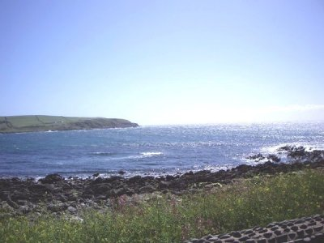
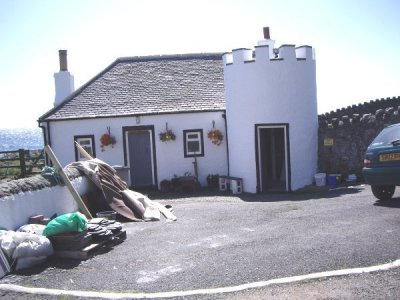
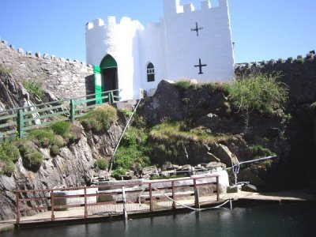
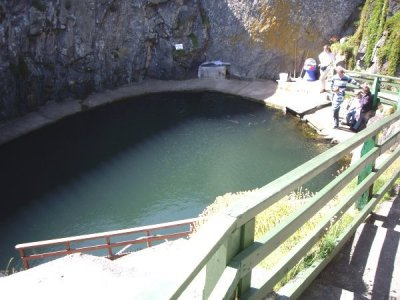
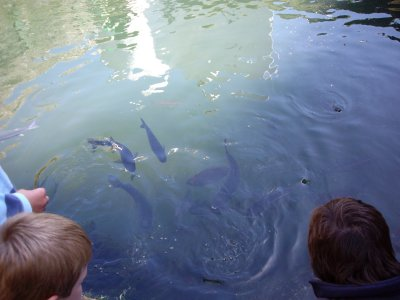
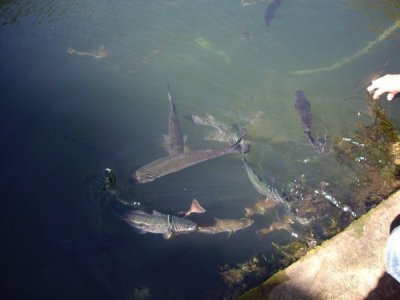
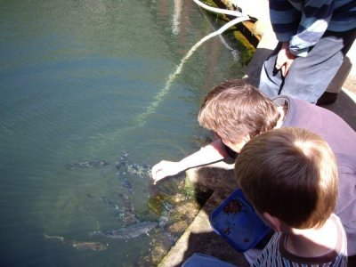

*Text and photographs by David Marshall*

The Logan Fish Pond is a unique visitor attraction snuggled into the beautiful Galloway (Southern Scotland) gem, which is Port Logan Bay.

<!--more-->

### History

In 1788 Colonel Andrew McDouall, the Laird of Logan, decided to create a fish larder for Logan House. As he knew of a blowhole, which had been created in greywacke (a form of slate) rock by the last Ice Age, only a stone's throw from the Irish Sea he decided that this would be the perfect place to build his fish holding pond.

Whether the gateway to the pond and its exquisite gatehouse were constructed before the pond itself no one is quite certain. To surmount the sheer drop from gatehouse to pond a flight of steps was built into the cliff side. By 1800 the pond was complete and would be 8' deep, have a diameter of 22' and hold 48,000 gallons of water. Natural filtration was achieved by allowing seawater to enter the pond twice daily. As the inflow of water was difficult to control extreme tides meant that water was capable of rising in the pond way above its intended level.

Fish were purchased from local fishermen and, in an age before refrigeration, stored here for use at the House. No more than 80 fish would be stocked at anyone time.

### Today

From the B7065 (you are a couple of miles from the famous Logan Botanical Gardens), a 'hairy' single-track road takes you to the gatehouse. The grass verges around the car parking area contain a wealth of plant life and on the day of our visit (late July) Sue and I were able to watch Cormorants dive for fish. During the summer months the attraction is open everyday.

As we paid our entry fee, £3.50, we joined our guide and a visiting family to enjoy the Logan Fish Pond experience. As we were here on a dry day the steps, the only means of getting close to the pond, were easy to walk down and it was possible to glimpse the silhouettes of a number of the 50 or so fish currently housed waiting for their next feeding.

The guide, who certainly loves her job, explained how several small aquaria would be back in operation very shortly but that, for now, the pond is the only display. New technology allows for the natural filtration to be controlled and I have to admit that the water in the pond was much clearer than I had expected.

Anemones and algae etc. grow around the pond producing an excellent native marine setting. As soon as the fish realise visitors are around they begin to gather for their next pellet feed. Several fish species are housed and these include Plaice, Cod, Turbot, Pollack and Wrasse. Not a seemingly unhappy or unhealthy fish here and the colours of some of the Wrasse were stunning.

*We really enjoyed our visit and if you are in the area I highly recommend a visit to what must be the U.K.'s most unique native marine aquarium*
