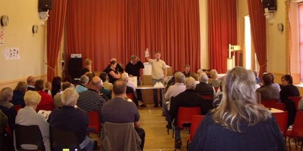

*Presentation photographs by John Hetherington, Workington A.S.*

*Text and other photographs by David Marshall*

Fishkeepers from across Northern England and Scotland joined the Ryedale members for their second open event of the year.

<!--more-->

John Douthwaite and Bede Kerrigan catch up on 'all things aquatic' with Scottish fishkeeper Kenny Young.

Putting together a min-show is not an easy task, as you need to formulate a small mixture of interesting classes and can never truly gauge how many entries you should expect to have as a 'happy with this' marker. So, on the day, we were really pleased to see 40 exhibits spread over the 7 classes. The first class for lady showers at a Y.A.A.S. event for many-a-year proved a big success.

As our photograph above shows Y.A.A.S. 'A' Class Judge, Mr. Trevor Douglas, was kept very busy. Fish species exhibited, ranged from a large Severum to small Galaxy Rasbora and from commonly seen Guppies to the rarely viewed Apistogramma 'species' Inca.

It was lovely to see all chairs taken in the auction area and people present catching up with 'old friends'. Our Auctioneer, Mr. Steve Jones, and his team did a wonderful job and sailed through the 14 'lots' without any problem. A wide variety of fish species, from large Pangassius catfish to young Convict cichlids, and aquatic accessories came under the hammer. Most bizarre 'for sale' on the day, was a breeding pair of Albino African Frogs (which produced a multitude of tadpoles for their 'new owner' (not me) within a few days of purchase).

*Our auctioneering team did an excellent job.*

A big THANK YOU goes to the Ryedale members, our friends from STAMPS, our friends from Scarborough & District A.S., and from Hull & District A.S. and for those other friends, who all worked together so well on the day on Ryedale's behalf, to all those who travelled to be with us (your support was truly appreciated) and the people who brought along wonderful fish for the mini-show and auction 'lots'.

That so many people left the venue smiling was testament to the lovely, but hectic, day we had.
