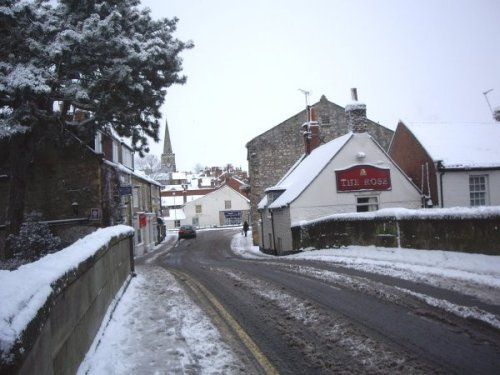
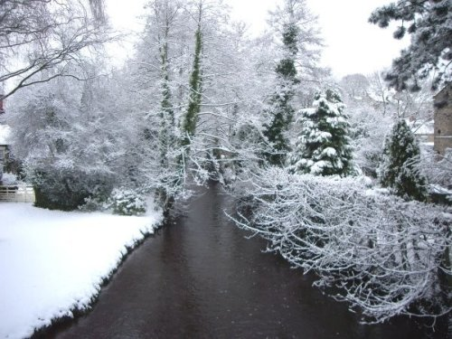

*Photographs by Sue and David Marshall*

This year, 2009, the Christmas Tree Festival at St. Peter & St. Paul's Church, Pickering (North Yorkshire) was held against the backdrop of the heaviest snowfalls Pickering had seen for many years. As you will see this created a 'photographers paradise'

<!--more-->

This year the Festival ran from Friday 11th to Tuesday 29th December. I decided to create a theme of 'tinsel and fins' for this years display. As the 25 fish disc ornaments from 2008 remained intact these would be used to form the basis of the display. Master Paul Story (the Grandson of our Chairman - Mr. Henry Hallsworth) used painted egg box segments to create 12 ornaments of his own while Miss Amy Charters answered our request for ornaments from our 'twinned' Society, STAMPS, by creating disc ornaments showing a Silver Shark and a Schubert's Golden Barb.

Wednesday 9th December marked Christmas Tree Festival decorating day! I was on my own for the morning decorating session, 10.00a.m. to 12noon, and chosen a very sturdy looking tree. I made a rough placement of the ornaments during this time.

Sue was able to join me for the full afternoon session, 2.15p.m. to 4.15p.m,and with ornaments and lights placed upon the tree the fins part of the job was nearly complete. For the tinsel aspect we placed these streamers around the tree base - along with information sheets about Ryedale A.S. and a blown-up Betta photograph as a background feature. Committee Member Mrs. Elizabeth Skellington came along to lend support. After school Paul was able to come along, in the company of his Mum Tracy, and place his ornaments to complete the fins section. By the time we left the tree was just as I had envisaged.

Sue and I returned for the final session, 6.00p.m. to 8.00p.m., and checked that everything was okay.

Our tree was one of 29 decorated by local hobby groups, local educational providers, local service providers and Christian groups. Spread out from the large entrance area, throughout the Church to the altar they created a beautiful display that complimented the famous Mediaeval wall paintings and formed a feeling of peace and humility. Well done for all the work put into the tree decorating by all concerned. It was lovely to see people of all age groups taking part during the different sessions. Now I know why Roy Wood said 'I wish it could be Christmas everyday'.

The British Legion Tree, to remember young men of the Pickering area lost in recent conflicts, was placed close to the Quaker Church Peace Tree

The Festival was officially opened, on Friday 11th December, with a selection of carols, traditional seasonal songs, organ recitals and readings put together by that wonderful choral group that go by the name of the Chanticleer Singers. Sue and I represented the Society and thoroughly enjoyed this evening. As the singers took their deserved applause the Church was darkened and the trees lit.

Sue and I returned on Tuesday 22nd December and this allowed us to take the Festival photographs that follow.

Although the Festival is all about friendship and community I have to confess that I was 'chuffed to bits' with all the lovely comments made about our tree by 'locals' who visited the Festival this year.
