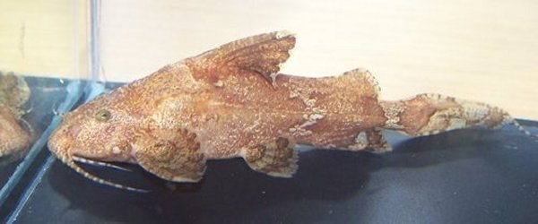

*Report by Dr. David Ford*

*Photographs as credited*

Held at the Old Malton Memorial Hall in Malton, North Yorkshire, on Sunday 11th July, the Ryedale Aquarist Society held their 25th Anniversary Day.

<!--more-->

This was more than an Open Show because the philosophy of Ryedale AS is "The little club with a big heart". There were 'Mini-Open Shows' for special entries, such as Ladies Day (AV fish owned by a lady) and Dastardly & Mutley (unusual fishes, not normally seen on the show bench). There was also a craft competition with photographs and miniature models

Friendship is always of paramount importance at Ryedale events and here we see Bede Kerrigan (STAMPS), Trevor Douglas (Hull A.S.) and Paul Barrow (TTAAFBAS 'A' Class Judge) enjoying their day. Photograph by David Marshall

This beautiful Synodontis, owned by Bede Kerrigan of STAMPS, is a hybrid cross between S. decorus and S. pardalis 'Czech variant'. He went home as the first fish to win a Dastardly & Mutley Class in the U.K. Photograph by David Marshal

BCA Secretary Jamie Horne called this intriguing male fish, which was entered in the Class above, a 'conica' as it is a Convict x Sajica Cichlid cross. Photograph by Dave Hallam (Sheaf Valley).

Ian and Mary Fairweather were thrilled to be asked to judge the craft competition. Photograph by David Marshall

Ian and Mary chose John Douthwaite's 'Snow White and the Seven Dwarfs' as their favourite craft item. Photograph by David Marshall

Jill Hallam, who took our photograph, made this beautiful Chocolate gourami cake that came a close second. We are reliably informed that members of Sheaf Valley A.S. enjoyed devouring this cake at their meeting the following evening.

The BCA (British Cichlid Association) had a Mini-Open Show with 4 classes. They also had an information stand at the Show. David Armitage of AAGB (Anabantoid Association of Great Britain) had a stand with aquarium fish on display and Fishphilosophy had a retail stand. David (Marshall) displayed the covers of, and posters about, Aquarium Gazette CD magazine but was too busy rushing around to have a proper stand on the day

Phil and Jade Blackburn recruit a 'little helper' from Scarborough as they man the Fishphilosophy stand. Photograph by David Marshall.

...

Dr David Ford of Aquatic Services gave a talk on 'How a Goldfish changed my Life'. He also helped judge the Open Show events, along with an FNAS 'A' Class Judge (John Cowan) and a YAAS 'A' Class Judge (Steven Grant) who pointed the 71 entries. Ian and Mary Fairweather judged the popular craft class. Steve Jones of the European Anabantoid Club then auctioned many items to an appreciative audience.

Dr. David Ford holds the winning photograph - a beautiful portrait of a Pseudocrenilabrus specie taken by Dave Hallam

Auctioneer Steve Jones has the help of Ryedale members Richard Hebden, Mark Lyons, Frank Tolomeo and Henry Hallsworth. Photograph by Dr. Ford.

Sue Marshall and her catering team made sure that the auction visitors were catered for with hot and cold food throughout the day. In keeping with the friendship theme a 'happy half hour' was held for tea and coffee. Photograph by David Marshall.

The main fish competition was a special 'Ryedale 25th Anniversary Championship' which was won by an unusual fish: Electris vittatus which is actually a family pet called George, by the owner, Phil Blackburn of Sheaf Valley AS.

George' the Electris vittatus, Winner of the 25th Anniversary Competition. Three YAAS, two TTAAFBAS and one FNAS 'A' Class Judges had their pointing scores averaged to find the Competition winner. Photograph by Dr. Ford

BCA Secretary Jamie Horne was responsible for all of the work that went into the BCA show and stand

*This Hara longissima catfish won a 'highly commended' card in the 25th Anniversary Competition*

In the BCA Mini-OS the highest pointed fish was a magnificent Neolamprologus daffodil, an African Cichlid owned by John Douthwaite of STAMPS (South Tyneside Aquatic Marine & Pondkeeper Society)

The aptly named Daffodil Cichlid was the top-pointed fish in the Cichlid OS. Photograph by Dr. Ford

John Douthwaite and Grandson Daniel Charters were in charge of the administration side of the day. Photograph by David Marshall.

Here are some of our prize winners, photographed by Paul Barrow:

David Hallam, whose wonderful Corydoras napoensis team, won the first ever Shanghai contest held in Yorkshire

Ellis Eyres, NEYGBKA, whose amazing killifish dominated the AOV African Fish Class.

Bede Kerrigan, whose Red Delta Guppy shone a blaze of colour in the livebearer Classes.

And finally Steve Jones, whom is always 'collared' to hand out the prizes at Ryedale events, seen here with the 25th Anniversary Fish winner Phil Blackburn of Sheaf Valley. Organiser and Ryedale Events Secretary David Marshall is on the left...who is to be congratulated on organizing a successful 25th Anniversary Show. Photograph by Dr. Ford.
