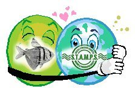

*Presentation photographs by Richard Hebden*

*Twinning logo designed by Dick Mills*

*All other photographs by David Marshall*

On Sunday 15th August the majestic Whistler Room at Pickering Memorial Hall played host to a special Twinning Day involving the members and friends of the Ryedale Aquarist Society and STAMPS.

<!--more-->

The day began with a special presentation on the subject of Pencilfish that was given by Miss Amy and Mrs. Wendy Charters.

Special guest for the event was Mr. Steve Dent of the Yorkshire Cichlid Group who presented two talks based around his favourite cichlids of South and Central America.

The people present enjoyed taking part in a food and drink quiz that was devised by Miss Sue Marshall.

Y.A.A.S. 'A' Class Judge Mr. Trevor Douglas judged the 9-class mini-show in which a total of 44 fish were entered. The quality of fish was excellent and included Corydoras pantanalensis, Chinese Roundtail Guppy, Schubert's Golden Barb and C6.

Mini-show prize-winners included:

David Charters

A sales table was also held with various cichlids, livebearers and fish foods causing much interest.

Finally, Twinning Day would not be Twinning Day without our traditional 'pot luck lunch'. A big thanks to all who brought along such a wonderful selection of sweet and savoury items!

A big thank you to all the people present for all the work that was done on this very special day and for friendship.

This very special photograph, featuring Bede Kerrigan and Frank Tolomeo, sums up what Twinning Day is all about.
