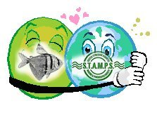
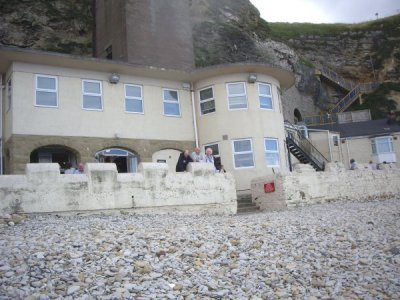

*Text and photographs by David Marshall*

*Photograph of Sue and David Marshall by Paul Barrow*

*Twinning logo devised by Dick Mills*

The morning of Sunday 12th September was absolutely beautiful as our next Twinning event took a small band of members from STAMPS and Ryedale A.S. to the pier at South Shields for a very special morning.

<!--more-->

On such a clear morning the view over the bay from South Shields pier to Tynemouth Priory was stunning.

Paul Barrow had organised a rockpool trip and had gone to much trouble making sure everything was right, including health and safety aspects, for what would be a very interesting 'creature hunt'.

As our photograph of John Douthwaite and grandson Daniel Charters shows the area we had chosen to sample is quite extensive.

The mounded area around the pier is dotted with rockpools and, as we would find out, many of the rocks here are well anchored into incredibly soft sand. For such a large stretch of beach things were incredibly quiet so only passing Swans and aircraft distracted from our task.

John and Daniel are joined by Paul Barrow (rear of our photograph) and Mark Lyons as our 'creature hunt' begins

Our task was not easy as we enthusiastically raked through watery sand and turned over rock in pursuit of whatever creatures lurked in the pools.

Wendy and Amy Charters plot their next move while Bede Kerrigan is in for a nasty surprise - the bite of a not very hospitable Crab.

Sue and David Marshall busy at work.

After much searching we managed to uncover a couple of small fish, several Crabs, a living Starfish, large shells complete with occupants and brilliantly coloured red anemones. As we finished this part of our morning Amy carefully placed all of the creatures we had found back into places of safety.

For the second part of our morning we conducted a survey of seaweeds found both in the rockpools and upon the beach. We had hoped to record 13 species and note their preferred environment and how abundant these species were? We found several of the targeted species but Paul was disappointed, and concerned, that we were unable to record all 13.

Finally, we conducted a survey of how many Limpets could be spotted in 60 seconds.

The two surveys were not conducted light heartedly and the information they revealed will be forwarded to the British Museum of Natural History as part of their national survey - the results of which you can find upon their website.

As we prepare to leave the beach Paul tells members of our party all about the geology of South Shields beach

As we said our 'see you soon', and the STAMPS members departed for home, our day was not quiet over. Bede took Sue, Mark and myself down the coast towards Whitburn. This gave us the chance to visit the infamous Marsden Bay. As readers of The Aquarium Gazette CD magazine are aware (see the article on modern day Sea Dragons by Richard Freeman in Issue 15) this Bay is alive with grizzly stories and has witnessed more sightings of the Shoney (a mythological/unknown water serpent) than any other area of the Sunderland coastline. You would be extremely lucky to see the Shoney but what you do find are amazing rock formations and a pub/café (with an amazing history) built into the cliff face. Our thanks to Bede for taking the time to show us around some beautiful coastline.

The great thing with 'Twinning Days' is that they allow you to have wonderful times like today and cement friendships. Thank you to Paul and his fellow STAMPS members for the wonderful day we had.
