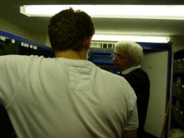

*Text and photographs by David Marshall*

*Tropical marine fish and photograph of David Marshall by Jackie Goulder*

*Group photographs by David Lawton*

On the evening of Monday 10th October members and friends of Ryedale Aquarist Society travelled to Ferrybridge Aquatics.

Our thanks go to the Lawton family, who made us so welcome and who contributed more than their fair share of food to a lovely 'pot luck supper'.

<!--more-->

BAT3 and Dragon goby 2 - From small Buenos Aires tetra to large Dragon goby you find a large array of tropical freshwater fish at Ferrybridge Aquatics.

Once again we found a vast array of tropical freshwater fish for sale that varied from tiny Rasboras to large Pike Cichlids; from commonly seen Tiger barbs to rare Leporinus and cichlids galore, which all compliment one of the best selections of Corydoradinae in Northern England. When our party was asked to name their favourite fish there was little doubt that a huge Motoro Ray would finish in poll position.

Beautiful Discus.

This Motoro Ray caused plenty of 'wows' from our party.

Since our April visit the tropical marine section has increased and houses high quality fish and invertebrates. As our photographs show some of the fish were stunning.

An excellent array of aquatic accessories and aquarium fish foods are also offered for sale at competitive prices. Many types of freshwater shrimps drew much attention.

We had a wonderful evening and the members had a real job choosing which fish species to bring home.

*Sue Marshall enjoying our visit*

*David Marshall looking at fish*

Once again we thank the Lawton family for their hospitality and thank Richard, Frank, and Jenny for providing the transport that enabled us all to attend.
