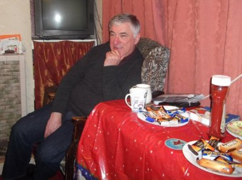
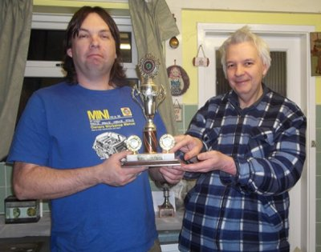

*Photographs as credited*

The 26th AGM of the Ryedale Aquarist Society was held on Wednesday 7th December 2011, at the home of members Sue and David Marshall.

<!--more-->

The official business was preceded by a hot dog supper and our thanks go to Sue Marshall for the supper organisation.

*Members relaxing in the comfort of Sue and David's home. Photographs by David Marshall.*

*The Committee elected to serve the Society for 2012 was as follows; -*

Chairman - Mr. H. Hallsworth.

Secretary & Treasurer - Mr. D. Marshall.

Show Secretary - Mr. F. Tolomeo.

Committee Members- Miss S. Marshall, Mr. R. Hebden and Ms. J. Goulder.

Senior Aquarist of the Year - Mr. R. Hebden.

British Telecom Xmas Trophy - Mr. R. Hebden.

Owner of the Best fish bred by a member during 2011 - Mr. D. Marshall.

Owner of the Best Egglaying fish - Mr. D. Marshall.

*David presents Richard with the Senior Aquarist trophy*

*Photograph by Sue Marshall.*

David presents Richard with the BT trophy

Photograph by Sue Marshall

Sue presents David with the Egglayer trophy

Photograph by Richard Hebden

Monthly meetings (1st Wednesday when possible) will be held at the Bay Horse Hotel, Pickering.

The annual Open Show will be held on Sunday 9th September 2012 at Old Malton Memorial Hall. Along with 40 Classes, covering the full range of tropical freshwater and coldwater fish, we will be hosting an auction of aquatic items.
