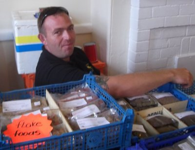

*Presentation photographs by Paul Barrow and John Hetherington (Workington A.S.)*

*Fish photographs by Steven Grant (Castleford A.S.)*

*Auction and traders photographs by David Marshall*

On Sunday 9th September 2012 Ryedale held their annual Open Show in The Memorial Hall at Old Malton. The show was split over the two halls - one for the auction, café and trade stands, the other, which was well lit, held the exhibits.

<!--more-->

In all there were 40 classes including an unusual class for albino and xanthic (yellow) fish. Entries came in a steady pace at first then slowed down; the problem being congestion both in and out of York slowing cars coming into Malton. Show Secretary, David Marshall, thus extended the booking-in for a further 30 minutes to allow time for people who had phoned explaining they would be delayed to get their fish onto the bench

The show was run to YAAS rules and standards with 3 YAAS Judges, Trish Jones, Kevin Webb & Trevor Douglas doing a sterling job assigning places. There were 164 entries from 16 exhibitors with more green cards, for the excellent quality of exhibits, given out today than at any other show, so far, in Yorkshire this year. These exhibitors travelled from various areas of the northeast, Cumbria and Yorkshire, all enjoying the day, mixing with each other and helping out.

Prizes were well distributed between the attending clubs, with Ashby Fishkeepers, Sheaf Valley A.S., STAMPS Castleford A.S., FAST, &, Workington doing particularly well. My club, Caer Urfa, won cards for the first time in several years at a Yorkshire show.

The major results were as follows:

Best in Show: Bernard O'Neill, Workington AS with a female Limia nigrofasciata.

Best in Show: 1st Reserve - Jamie Horne, Sheaf Valley AS, with a Scleromystax kronei.

Best in Show: 2nd Reserve - Jamie Horne with a Hemaloptera confuzona.

Best Exhibit - Steven Grant, Castleford AS, with a pair of Bunocephalus amaurus (a Banjo Catfish specie)

Best Goldfish - Jim Haworth, Castleford AS, with a Single-tailed Goldfish.

With Ryedale members Frank Tolomeo and Richard Hebden putting everything together Steve Jones (European Anabantoid Club) conducted the auction with the likes of Bede Kerrigan (STAMPS) doing the running - as well as a stint selling raffle tickets with Miss Sophie Banks (OASIS).

A good selection of fish & goods went through the auction. Being a Yorkshire show; auction lots weren't restricted to fishkeeping with a good selection of houseplants on the lists.

The Guppy Section of the British Livebearer Association put on a small display stand.

Phil Blackburn had his Fishphilosophy trade stand and was selling a good range of fishkeeping accessories. Squama made their first appearance at a YAAS/TTAA event and were selling a selection of SAK foods (which are made in the Czech Republic)

Not only does Ryedale have the reputation of having one of the most friendly atmospheres of any Open Show but the small band of members (David, Sue, Henry, Ann, Frank and Richard) have the ability to put on show where everyone is willing to help, and which promotes a happy friendly atmosphere between different clubs and Federations. The Ryedale club must be congratulated on putting on another very enjoyable show.

Finally David asked me to thank all of the people from YAAS and TTAA Affiliated Societies who came along to help, to the people who brought along auction lots, the people who brought along their fish to show and to the traders who came along with their stands.

PLEASE SUPPORT THE PEOPLE WHO SUPPORT OUR HOBBY

THE RYEDALE AQUARIST SOCIETY MEMBERS SEND A BIG

THANK YOU TO THE FOLLOWING FOR THEIR KIND SUPPORT

OF TODAYS EVENT

AQUATICS

SEAQUARIUM/ WATERLIFE AQUATIC PRODUCTS

ROSEWOOD PET PRODUCTS LIMITED

AQUA PACIFIC U.K. LIMITED/AQUA ONE AQUARIUM FISH FOODS AND PRODUCTS

FERRYBRIDGE AQUATICS, MAIN ST., FERRYBRIDGE, W.YORKS.

JMC AQUATICS LIMITED

JUWEL AQUARIUM (U.K.)

FISHPHILOSOPHY, WORKSOP

SAK FISH FOODS/SQUAMA U.K. LTD.

THE AQUARIUM GAZETTE, COMPUTER DISC & E-MAIL TRANSFER MAGAZINE

F.B.A.S. OPEN SHOW SUPPORT PACK:

TETRA U.K.

ROLF C. HAGEN LTD

TOURIST ATTRACTIONS

EDEN CAMP MUSEUM, MALTON

THACKRAY MUSEUM, LEEDS

DRAGOON GUARDS MILITARY MUSEUM, YORK

NATIONAL TRUST - FOUNTAINS ABBEY AND STUDLEY ROYAL PARK, RIPON

'BRITAIN AT WAR' WORLD WAR II EXPERIENCE, LONDON
