*Text and photographs by David Marshall*

### Introduction

Very few of us ever have the chance to get on board a submarine and explore the wonders of the oceans. However, there is a Public Aquarium, based at Hull in East Yorkshire, known as The Deep that can give us a good idea of what a submarine journey may be like as it advertises itself as the World's only submarium.

<!--more-->

A few weeks after The Deep first opened, in March 2002, Sue and I made our first visit and had always planned to return but time had slipped by so it was not until the summer of 2012 that we would walk through the entrance doors once more.

After hearing about several new exhibits, learned that the only Green Sawfish/Shark to be viewed in Europe was here and that the Curator of exhibits at The Deep was hoping that the aquarium would be the first in the U.K. to be offered membership of the prestigious World Association for Zoos and Aquariums (WAZA)* I eagerly awaited a second look around The Deep.

### The start of our visit

The Deep is situated in the former dockland area of Tower Street. What we learned was that when you head for The Deep, by car, be careful with satellite navigation equipment as this easily takes you to a small Hull Council Car Park, which I have to admit does have good views over the Humber Estuary, instead of the large Car Park at the aquarium itself.

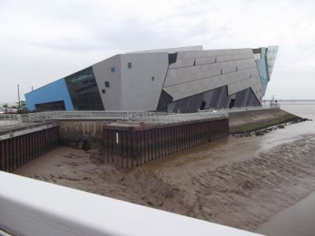

*The very futuristic building looks like something from a cyborg movie and whether or not this impresses you you are going to love the exhibits inside.*

When you arrive at the Public Entrance be prepared to queue, as this is a very busy place. At least they have a lovely Silver Bream exhibit that you can view whilst waiting to purchase your entrance ticket. Such is the forward looking attitude of The Deep that you don't get an actual paper ticket but a swipe card with the portrait of a fish on it.

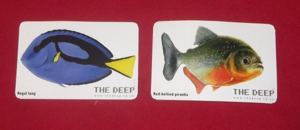

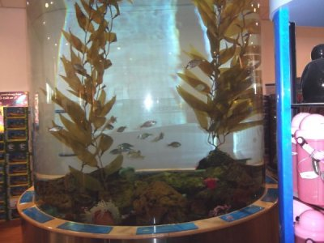

*Swipe card entry tickets.*

*Silver Bream Exhibit.*

Through the turnstile, and you have to take an upward journey, by stairs (3 flights) or lift, to get to the start of the exhibits.

### The exhibits

These begin with 'Visions of the Ocean' that looks at mans perception of our Oceans. Here you find a wonderful aquarium, with a title of 'stranger than fiction', that is set-up with ocean sand and coral and is home to tropical marine Pufferfish, Copperband Butterflyfish and Filefish. An audio-visual presentation follows.

'Timeline: awakening seas' takes you down a ramp towards an exhibit of living Jellyfish. Here are a number of audio-visual displays that tell you the story of evolution from the emergence of microscopic life in the oceans, to the rise of fish, the coming of aquatic mammals and, finally, the arrival of man on Earth. You have some fantastic representations of fossil fish to view.

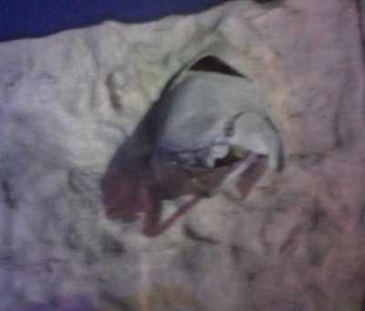

*Representations of fossil fishes.*

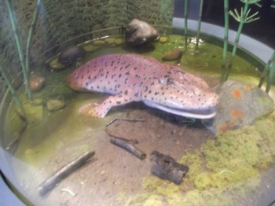

*The amazing Tiktarlik exhibit.*

You are now into the exhibits proper as you enter 'Lagoon of light and coral realm'. Things begin very cleverly, as a model of the prehistoric amphibian Tiktarlik rosae is placed as though a living creature, to show the continuity of ages between extinct and present day aquatic life. Now you are looking at a splendid mangrove habitat that exhibits Atlantic Mudskippers to the full. To your left is a lagoon exhibit, the second largest exhibit in the building, which is home to a variety of stunning tropical marine fish that include Fingerfish and Yellow Tangs.

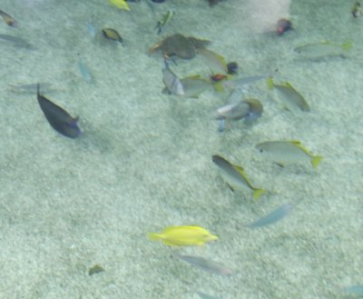

*The lagoon exhibit.*

*Some of the stunning fish exhibited in the lagoon.*

Now we are at 'Discovery centre' where children learn about life in rockpools and are helped by a very clever interactive game, built into the floor, which allows them to recognise various creatures.

At 'wave power' we have three really nice exhibits. Chief of these is the most beautiful coral exhibit I have seen at a U.K. Public Aquarium. This is a long and deep, but not very wide, aquarium. Swimming among several forms of coral (including leather and colt) are Purple Tang, Clownfish and Pyjama Wrasse. You have to see this exhibit to understand its beauty.

Next we are in 'Endless Ocean'. This is the largest exhibit. Here I achieved an ambition as I had always wanted to see a Green Sawfish and was a little in awe (although a Staff member told me that the Sawfish can be a 'nasty piece of work'). Several other species of Shark and some large Trevallys share the space. Make the most of the large window as there are not as many viewing opportunities to make the most of this large exhibit as we had remembered from our first visit.

Built around the above exhibit is 'Slime'. They have placed a wide variety of 'creature exhibits' here from Giant African Land Snails, to Tiger Slugs to Poison Arrow Frogs. If I had to pick a favourite it would be the Garden Eels as they 'bob' in and out of the substrate like the weird creatures they are.

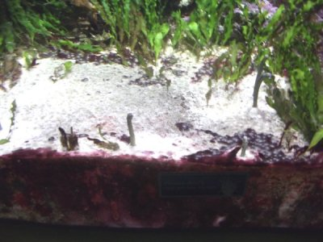

*Garden Eels*

At the end of this hall you have a large tropical freshwater aquarium that looks like a cinema screen. Named 'Flooded Forest' there are a number of large sized rescued Amazonian fish here that include six Black Pacu, a Tiger Shovelnose Catfish, a Motoro Stingray, two Amazonian Red-tailed Catfish, two armoured Niger Catfish and a Silver Arowana. What I like is that the fish have plenty of space to move around in.

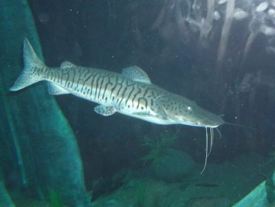

*The Flooded Forest exhibit*

*The Tiger Shovelnose Catfish.*

Although there have been interactive and audio-visual presentations from the start, 'Cool seas' begins what we will call an overdose of modern learning and sometimes you think you are on the bridge of Battlestar Gallactica rather than in a Public Aquarium. We just stepped back from this and enjoyed the living exhibits. There are Nautilus, Lobsters, Wolfish and others. However, the highlight is a large aquarium with Pollack, Brown Wrasse, Mullet, John Dory and Spotted Floorwalker.

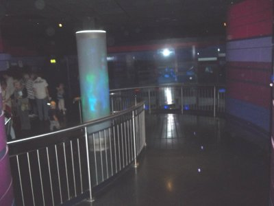

*Cool Seas' area*

'Kingdom of Ice' is all about interactive exhibits that explain how the Antarctic works. The only living creatures are Glass Shrimps.

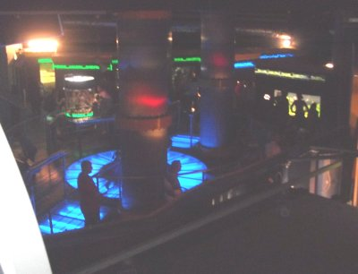

*Living Rivers' is awash with interactive stuff and living fish.*

Now we are into 'Living Rivers' - which is not easy to locate so go towards the eating area at 'Kingdom of Ice' and look for a downward ramp. . Here you use your imagination; plenty of interactive stuff, and are the Captain of a submarine that monitors the quality of water in the Earth's main river systems in the year 2050. In reality what you have is a brilliant idea of taking seven famous river systems and making one aquarium for each that represents the decor and flora you would find there. One fish species then becomes the highlight so you have Red-Bellied Piranhas for the Venezuelan Orinoco and Grey Knifefish for the Congo. To compliment you have a small exhibit of Leaf Cutter Ants. Excellent.

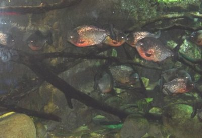

*The Red-Bellied Piranhas*

*D14 - The Red-Bellied Piranhas*

Finally comes 'Research and Conservation' that tells you about the conservation and project work The Deep is involved with away from the building itself.

So back down the stairs (we lost our way a little) and you exit through a well stocked gift shop.

### Conclusion

We thoroughly enjoyed our visit and will soon return. Sometimes the interactive exhibits can be a little overpowering but folk from younger generations than ours will, I am sure, love it. The majority of the fish exhibits are excellent. There are plenty of places to eat, seating around many of the exhibits and excellent toilet facilities. A submarine journey with all the comforts of home!

*On 12th October 2012 The Deep became the first aquarium in the U.K. to be invited to join the prestigious World Association for Zoos and Aquariums (WAZA). WAZA is the unifying organisation for the World zoo and aquarium community. There are over 300 members across the World from leading zoos, aquariums, associations and corporate partners who aim to work together to ensure the best possible animal welfare for the creatures in their exhibits as well as actively participating in projects to help conserve various animals and their natural habitats
