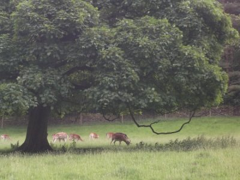
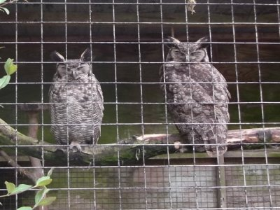
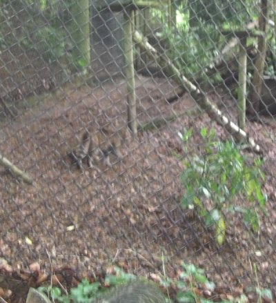
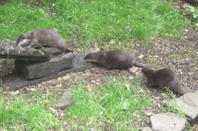
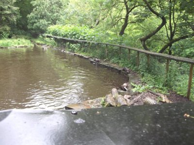
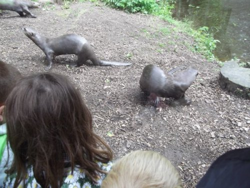

*Text and photographs by David Marshall*

The Derbyshire Peak District is an area of outstanding natural beauty that attracts thousands of visitors and walkers each year. Fishkeepers have extra reasons to be attracted to this area as there are several aquatic retail outlets you can visit as well as the wonderful, and very different, Public Aquarium at Matlock Baths (which we have already reviewed). However, there is also a unique, and amazingly beautiful 50 acre conservation park known as the Chestnut Centre that is of great interest to those of us with a broad interest in aquatic life as it is home to an equally unique collection of aquatic mammals complemented by a whole host of non-aquatic creatures.

<!--more-->

Making your way to Chapel-en-le-Frith you will easily find signs for the Chestnut Centre. Set in what were the grounds of a stately home, the parkland varies from deer park to the beautiful setting of a riverside woodland walk..

It is the deer park, which accounts for around half of the walking area, that starts a visit and here you will find a beautiful herd of Fallow and Sika Deer. When Sue and I were here a few years ago we were virtually looking at shadows in trees but today, late May 2013, the Deer were much more active and thus very visible. We felt very fortunate when two young stags decided to walk down to the footpath and, as the photographs show, we got very close to these beautiful creatures.

These two beautiful stags came very close

Now you enter a large woodland area, which in some places is not easy walking, and soon find yourself at an Owl enclosure. You will be amazed as, spread over three areas, you will find, if I counted correctly, sixteen different species of Owl from all around the World. All have spacious enclosures that allow for 'escape' from prying human eyes. The information boards are excellent and tell you all you need to know regarding each individual specie. My favourites were the Burrowing owls and they scurried along the floor acting more like tiny mammals than birds.

These Owls are very much at home in their spacious enclosure.

\- Excellent inform.ation boards tell you all about the various

### Owls on view

European mammals also feature with enclosures for Polecats, Pine Martins, Red Fox and Scottish Wildcats. Watch out also for a large number of 'free living' Grey Squirrels that amused us by teasing the Pine Martins they knew could not get at them. The European mammals are so at home that you need to be patient as they can be hard to view in the amazing natural settings of their enclosures.

*The Wildcat enclosure.*

However, from an aquatic point of view, the highlight of your visit will be the collection of amazing Otters. Again these creatures have enough space to move around in and areas in which they can escape from the glare of visitors.

These begin with a pair of Short-clawed Asian Otters. I love these characters and you will encounter a further two groups of these delightful creatures as you move along the woodland paths. A keeper told us that the Chestnut Centre has played a vital role in the international conservation schemes that try to re-establish pairs of Short-clawed Asian Otters to former Asian habitats.

*This family group of Short-clawed Asian Otters decided to 'go walkabout'.*

A pair of North American Otters follow. When we visited, the male was letting all of the creatures around know that this was his 'land' by continually marking and patrolling his territory, while his female kept a sensible distance.

A pair of Eurasian Otters were acting much more sedately and so were harder to spot. These are very gracious creatures and you will encounter another enclosure as you walk around the woodland.

But the real 'stars' are found in the former boating lake. Beautifully 'aquascaped' with trees, rushes and water cabbage this large pond is home to a pair of Amazonian Giant Otters and a young daughter from their only, so far, brood of young. Around the pond there are a number of viewing places (watch out for the Badger set) and platforms, however, none can guarantee you a view of the Giant Otters 'in hiding'. We visited on a Monday. Around mid-day the trio were given a public feeding and this is your best guarantee of actually seeing them. Hearing them is also special as what a noise the male makes.

Knowing that it was feeding time three whiskered heads suddenly appeared from nowhere as these Otters literally glided towards their food source. In water these massive, (when compared to the other Otter species here), creatures are truly at home and as they received their 'treat' of Carp, they dispatched these fish like they do Piranha in the wild by biting at the head first. The youngster enjoyed playing with her dinner while the adults made quick work of theirs. Local Herons had visitors amused as they tried to 'snatch' a meal and came right down onto the fencing.

I did my best to get some good photographs but this proved very difficult, as when the Giants are on land you have to try and photograph through thick glass/acrylic. It is amazing how clumsy these Otters look on land, when compared to their smaller cousins, and it was easy to see why they are so vulnerable in the wild to human poachers.

*The trio feeding*

Watching for Herons.

As we made our way back through the deer park we called into the café. A last 'treat' was waiting as with a number of pre-school children here with their parents, the Staff brought in a beautiful Barn Owl for us all to see and touch.

The Chestnut Centre is a beautiful place to visit. You need to give yourself plenty of time and choose a fine day to visit. Taking a good pair of walking shoes/boots is essential. Although 'visitor friendly' there are large parts of the walks that are steep and visitors who find walking difficult would struggle with these paths. And what a memory those Giant Otters will leave in your mind! If these creatures were to become extinct in the wild, it would be a true crime against nature.
