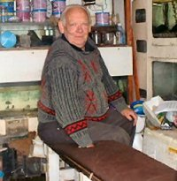

Remembrance of my friend

On Tuesday 6th December 2012 my friend Mr. Gerald, or Gerry to his fish friends, Hawksby passed away.
<!--more-->

Although I had talked with Gerry several times before he gave a first talk to the members of the Ryedale Aquarist Society, early in 1985, this was the night our friendship actually began and would last for close to 30 years. Before illness struck Gerry, I spent many happy hours in his fish house at East Ayton talking about aquarium fish of all types; the history of the hobby; Aquatic Societies and our other shared interests of the natural world as a whole and, maybe surprisingly, the Dad's Army comedy series (Gerry liked the characters more than the comedy aspect as they reminded him of folk he had known in his youth). We were always surrounded by various colour forms of Angelfish, usually in the act of spawning, and killies dashing around in aquaria large and small.

Gerry's fishkeeping interest had begun in the years following the ravishes of the Second World War. Any form of aquatic literature had yet to be re-established but the Editor of a best selling cage and aviary bird magazine had got his act together and, seeing the growing interest in tropical fish, had decided to give over a couple of pages of each issue to fishkeeping. Gerry was always very meticulous so he carefully removed these pages, read and re-read them and when he felt ready to take the plunge purchased an aquarium composed of a slate base and four glass sheets held together with putty. What we would class as a primitive heater sat under the base. Gerry told me that he would watch the activities of the White Clouds it contained, noting everything about them that he could.

However, it was when Gerry was working as a clerk for British Rail at York that the big push happened with news, heard from fellow fishkeepers at the Station, that a group of fishkeepers in the City were planning to expand their hobby activities under the name of the York & District Aquarist Society and would be seeking membership of the then Yorkshire Federation of Aquarist Societies. Gerry made enquiries, became the Secretary of the group and at a time when any self respecting Society had a Newsletter was soon editing this publication. Although he would go on to do so much for this Society, the thing he always talked the most about was the excitement of the team work that went into producing several tableaux for the very prestigious Yorkshire Aquarist Festival at Doncaster Racecourse.

Attending Open and Interclub shows would then see Gerry make friends with folk from fellow Y.F.A.S. affiliated Societies. With a need for speakers Gerry decided to try his hand and was soon going around Yorkshire speaking on the subjects of living foods for fish, fish on postal stamps and killifish. A growing interest in killies would see him not only join the British Killifish Association, of which Gerry was a member for many years, but also help to establish the N.E.Y.G.B.K.A. - the Open Show of this group was one of the highlights of the year as far as Gerry was concerned.

When the Y.F.A.S. changed constitution and name to become the Yorkshire Association of Aquarist Societies, Gerry continued his work with the York group and his speaking. He also expanded this interest to help newly starting clubs becoming established and this would gain him Honorary Member status at Bridlington & District, Scarborough & District and Ryedale Aquarist Societies.

At Bridlington, the highlight was the annual invite to judge the members annual furnished tank competition. At Scarborough, it was helping with the annual Open Show and later taking on the post of Secretary. With Ryedale, it was attending meetings at which a speaker would be present, attending social evenings and judging at our AGM fish competitions. However, what I will always cherish the most are the nights when Ryedale took part in the heats for the F.B.A.S. Aquachamp Contest (to find the non-professional person with the most knowledge of aquarium fish). Gerry would insist that the question papers be sent directly from the F.B.A.S. to his home; would then practice the correct pronunciation of any scientific names; do a Quizmaster job that Magnus Magnuson would have been proud of; personally seal the answer papers and then walk over the road from our venue and post the envelope back to the F.B.A.S. That was Gerry.

Now, we must remember that fish were not the only interests Gerry had as he was an accomplished amateur astronomer; kept meticulous records of Formula one motor racing for many years; had an interest in both snooker and tennis; was a Committee Member at his local Church and loved the call to go and help with fish frying when the well-known Walkers fish and chip restaurant first opened at West Ayton.

Sue and I will miss Gerry very much as he was a good personal friend to us both and a mentor to many in the hobby, including myself. The fishkeeping hobby has lost a true pioneer who gave so much to a hobby he loved. Although he was a font of knowledge, he always acted in a quiet way, never seeking attention or pushing himself too far forward. Gerry, you were a true gentleman.