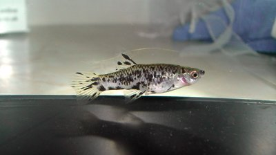

*Text and photographs, unless otherwise credited, by Dr. David Ford of Aquatic Services*

The14th Ryedale Aquarist Society annual Open Show and Auction was held at the Old Malton Memorial Hall, Malton in North Yorkshire on Sunday 18th May 2014. This popular Open Show had 39 Classes of fish exhibited under YAAS rules (Yorkshire Association of Aquarist Societies - in 'slab-sided tanks with a black base'). The Ryedale A.S. is a very social club and has its own exhibits too, such as the Eggshibit where exhibitors decorate a boiled egg to look like a fish!

<!--more-->

The exhibits entries. As Paul and Janice Barrow, who sponsored the main prize, were asked to judge this contest Trish Jones was allowed to enter and took first place with her goldfish eggshibit. Photograph by David Marshall.

Judging -Trish was part of the YAAS 'A' Class judging team alongside Trevor Douglas and Kevin Webb.

There were 96 fish entries in the Open Show that were benched by 12 families. When you put on an Open Show you never really know what is going to happen and today almost a third of the entries were made by Roy Chapman, all the way from Southend-on-Sea. Roy is a member of the Southend Leigh & District Aquarist Society, which will celebrate its 80th year in 2015. He is hoping for the winning maximum showing points in the year, which may well win him the FBAS Diamond League, hence he is taking his prize fish to many Open Shows around the country.

Roy Chapman (on the left of our photograph) was the exhibitor with the most points from fish exhibits.

\- Some of these points were gained by this beautiful killifish.

It is no surprise to be able to report that Roy was the most-pointed winner at the Ryedale Show with many firsts, second and thirds. However, the two major awards under YAAS rules are the Best in Show (single fish) and Best Exhibit (highest pointed pairs & breeders), which this year went to Yorkshire fish owned by the Yorkshire Club, Castleford AS.

Best in Show with 87 plus one third point was the tiny Rasbora Microrasbora kubotai sometime called the Green or Yellow Rasbora. This was the first ever showing by the fish owned by Jim Haworth of CAS.

Mr. Jim Haworth with Best in Show prizes

The Best in Show winning fish. Photograph by Steve Grant.

The Best Exhibit was won by the CAS Secretary, Steve Grant with a pair of Banjo Catfish Bunocephalus lari, one of the rarer species of Banjos. This was also a first-time exhibit for the fish (but difficult to photograph on the black base of the YAAS show tank!).

Steve Grant (on the left of our photograph) is presented with show prizes by Open Show Secretary David Marshall.

The Best exhibit award was presented to these stunning catfishes.

When the Ryedale Society held their first Open Show, the North East Goldfish Society hinted that it might be a nice idea to give a Best Goldfish Award. This hint was taken onboard so at this event you will find the only Best goldfish Award at a general Open Show in the North of England. As you will see from our photographs the Nelson family of Ashby Fishkeepers took this honour with a superb Common goldfish.

\- .

The photographs below came to us courtesy of Steve Grant and show a small variety of the fish species on the show benches

During judging, an auction of fish and aquarium accessories, consisting of 12 lots, was held. The auction lasted all afternoon with Auctioneer Steve Jones of the EAC entertaining an audience of some 60 aquarists'. As far as I am aware, the person who had travelled the furthest distance, with his non-fishkeeping wife for company, in order to attend the auction had come all the way from Birmingham. Both were so impressed by the friendly atmosphere of the event as a whole that they promised to return in 2015.

These photographs were taken from the stage by Richard Hebden. Can you spot any familiar faces?

Hot & Cold Food and drinks were available all day and there was one commercial stand by Fishphilosophy of Worksop. Mr. George Baker, who has just re-joined the Ryedale A.S. after a twenty year break from fishkeeping, was also present, selling tickets, with the groups permission, for a special raffle. The proceeds of this raffle will help to send his Granddaughter on a special project to help with a housing project in Borneo.

The Ryedale members send their thanks, through me, to the small army of helpers from the Y.A.A.S. and Caer Urfa Aquarist Society (TTAAFBAS) for their wonderful help, to all the exhibitors who brought along their best fish, to the people who brought their auction 'lots', aquatic industry and tourist attractions for their generous support, to all their friends who made the journey to be with us and the large number of interested visitors from the Ryedale area who came along to view the fish exhibits.

In 2015 the Ryedale Aquarist Society will be celebrating their 30th Anniversary Year and knowing 'the little club with a big heart' they will have a special Open Show planned so if you were unable to attend this year keep an eye open for details.

PLEASE SUPPORT THE PEOPLE WHO SUPPORT OUR HOBBY

AQUATICS

REEF ONE/BIORB AQUARIUMS

SEACHEM NUTRI DIET AQUARIUM FISH FOODS/ALF (AQUATIC DISTRIBUTORS) LTD.

AQUARIUM MUNSTER AQUARIUM PRODUCTS

DR. BASSLEER AQUARIUM FISH FOODS

SEAQUARIUM/ WATERLIFE AQUATIC PRODUCTS

FERRYBRIDGE AQUATICS, MAIN ST., FERRYBRIDGE, W.YORKS.

THE AQUARIUM GAZETTE, COMPUTER DISC & E-MAIL TRANSFER MAGAZINE

JMC AQUATICS LIMITED

NEW ERA AQUARIUM FISH FOODS

FISHPHILOSOPHY AQUARIUM FOODS AND ACCESSORIES, WORKSOP

F.B.A.S. OPEN SHOW SUPPORT PACK:

TETRA U.K.

ROLF C. HAGEN LTD.

TOURIST ATTRACTIONS

EDEN CAMP MUSEUM, MALTON

THACKRAY MUSEUM, LEEDS

NATIONAL TRUST - FOUNTAINS ABBEY AND STUDLEY ROYAL PARK, RIPON

THE DRAGOON GUARDS MILITARY MUSEUM, YORK

LOCAL BUSINESS

FAB BALLOON & PARTY HIRE, MALTON
