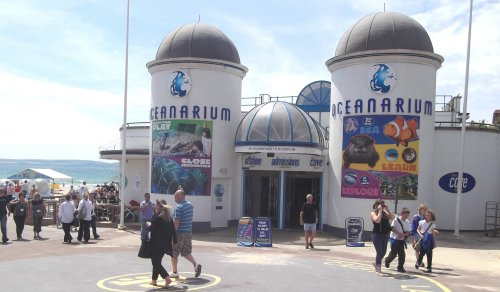
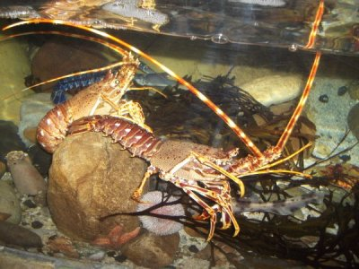
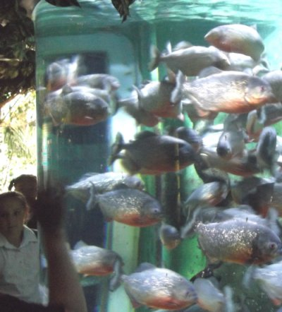
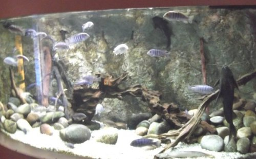
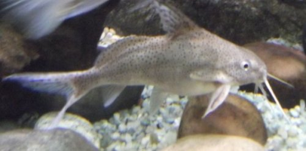
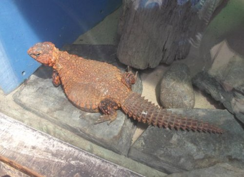
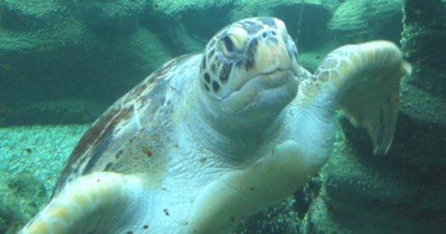
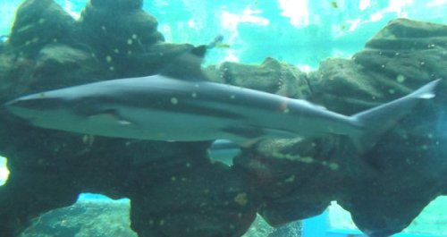

*Text and photographs by David Marshall*

The Oceanarium at Bournemouth is very easy to find as it is situated right on the sands of West Beach adjacent to the Pier and opposite the beautiful theatre park gardens (watch out for some very tame Squirrels and interesting aviaries).

<!--more-->

*The Aquarium entrance*

I have to confess that I had expected The Oceanarium to be housed in an older building and not the very modern one that we found. One word of warning! If you need to make use of the toilets go, via the gift shop, before you purchase an entry ticket to the exhibits as you have a job getting back into the exhibits otherwise.

Like so many modern Public Aquariums the Oceanarium follows the American style of having thirty displays. These displays are spread over two floors. There are information boards to accompany all of the displays but these tend to be basic when compared to those at many other Public Aquariums in the U.K.

The first four aquariums on floor one are built into a wall that divides the exhibit area from the cafeteria - which itself was very busy on the day Sue and I visited. Three of these house a selection of tropical freshwater species and the fourth a re-creation of a section of the Pier support that houses some wonderfully coloured native marine Wrasse.

Now we are at the first of several spectacular exhibits of tropical freshwater fish. This one features fish of the America's. This is a wonderful sight with a large round open-topped affair containing a group of large Red devil cichlids, Metynnis species, Motoro stingrays, large loricarins and Pimelodus catfishes.

*04 - Fish of the America's display..*

*Some of the amazing Red devil cichlids*

Next, we either take a lift or the stairs to floor two. If you take the stairs you can view 'Terrapin paradise' where several Red-eared terrapins are housed.

As you enter floor two you find yourself in a rainforest area. The first exhibit is a large oval tank that is home to a large shoal of Red-bellied piranha. This offers a perfect opportunity to view the remarkable body colours these fish show. For fish with a man-eating reputation, we caught feeding time with vegetable pellets the surprise order of the day.

*Piranha display*

A film, running on a loop system, warns about purchasing fish that will grow too large for the average aquarium and is the perfect lead into one of the most spectacular aquarium displays I have seen. A very spacious aquarium is home to a collection of rescued and donated fish that include some extremely large Black pacu, Pseudoras niger, Tiger shovel-nosed catfish, Giraffe catfish, Sorubim lima and the largest African Aluminium catfish I have ever seen. I stayed ages here and found watching the amazing activity that was going on much easier than trying to take decent photographs.

Stars of the next small section are a pair of Oriental small-clawed otters that were certainly 'in charge' of their spacious display area. This area has a variety of water and land sites. An aquarium employee was telling Sue how the Otters like to look out of their exhibit windows and watch people playing on the beach below.

Now we are at a large Rift Valley display. Not only do you find some quality Mbuna cichlids here but also there are several species of my beloved Synodontis, including two very large acanthomias that were 'bossing' the others around and a large Senegal birchir.

*The Rift Valley aquarium.*

*Some fantastic Synodontis catfishes could be viewed in this exhibit*

From press releases sent to Aquarium Gazette magazine, I knew that the tropical freshwater exhibit 'Ganges' was a large display containing a wide variety of fish species. I don't know what had happened but we didn't find exactly what was expected here but instead an exhibit that was in a re-construction phase and contained a large number of various young Puntius barbs, Asian catfish and Asian loach species. If all these species will live in harmony when they reach full size then this will be the spectacular display talked about in the releases. Go around the back of the exhibit and you will come face-to-face with 'Ziggy', a large Water dragon with a tail measuring two thirds of its entire body length.

A number of small tropical marine displays, under the banner of 'Marine Research Lab', come next. There are some nice fish and corals to view but this area needed a little work on the decor so on the day of our visit, the creatures on display, were not to be viewed at their best.

Horsefield tortoises, Spiny tailed lizard and Southern painted turtle follow and these creatures were all well exhibited and in perfect health.

*Spiny tailed lizard.*

'Great Barrier Reef' is a tropical marine walk through tunnel containing a large selection of fish, all in good health, including Black tipped reef sharks, Nurse shark, Bigeye jack, Moray eels and two large Green turtles housed here after injuries prevented their return to the sea. Readers of Aquarium Gazette will know how loved these Turtles are by the Aquarium staff and the strange adventures they get up to.

*One of the Green turtles*

*A Shark*

In 'Abyss' there are several native marine displays which house a good selection of fish, and crustaceans that live in a world without light. I loved the Wolf fish.

Finally, comes another large tropical marine exhibit whose occupants include Porcupine puffers, Guitarfish and Epaulette shark. This display is used as a message board to highlight environmental problems that are going on in our oceans.

By now we are back on the first floor as we exit the building via the well-stocked gift shop.

Sue and I enjoyed our visit. There are fish exhibits here that will appeal to most fishkeepers and if, like me, you love catfish, then there is the best selection of such fish I have seen at a U.K. Public Aquarium.
