*Photographs by Sue and David Marshall*

Anybody visiting the Scottish Borderlands cannot help but be impressed by the town of Jedburgh. Here the almost unreal Abbey ruins dominate the landscape of a town like nowhere else Sue and I know in the U.K.

<!--more-->

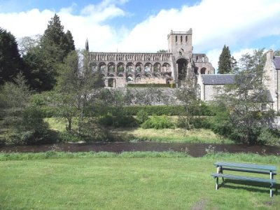

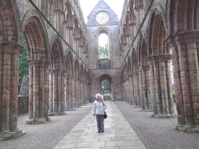

*Jedburgh Abbey*

If you take the Kelso road from Jedburgh (A698) you will come to a Garden Centre with the title of The Teviot Smokery. Here you will find all of the usual items offered for sale at such places, plus an aquatic hardware section selling own branded foods for pond fish and a good stock of pond accessories.

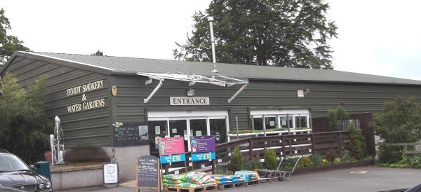

*The Teviot Smokery*

Walk through the Garden Centre, after enjoying a coffee in the lovely cafeteria, and you will find yourself in an open area.

The first feature you will find is a small coldwater fish sales area. On the day of our visit 8 small and 4 large vats were in operation and held a good variety of quality fish that included Black Sturgeon, various forms of Ghost Koi, Mirror Carp, Golden Tench, Golden Orfe and Barbel.

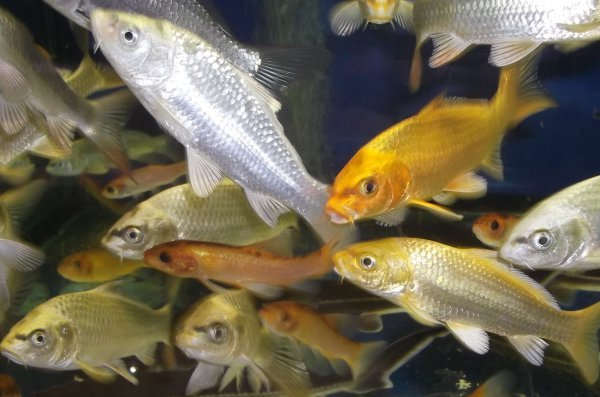

*Various Ghost Koi and Golden Tench*

Next comes a very impressive show pond that contains some amazing fully grown Blue Orfe, Rudd, Koi and Ghost Koi varieties. I just stood for ages and watched the various activities going on here.

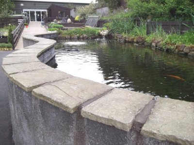

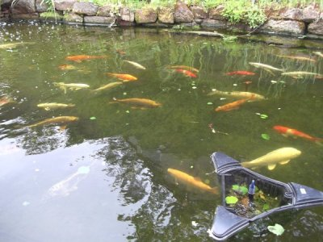

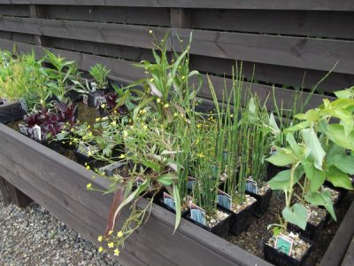

*Into the plant section and the choice of plants for both ponds and water gardens is excellent.*

Now turn to your right and you will see a bank of sixty gradual steps that take you down to the river front. It is absolutely beautiful here as you have a wide view of both the waterway and the natural landscape around it. Various birds flew around us and we were told that, if you are lucky, the local Otters might make an appearance. On a warm day you are welcome to walk for miles along the riverbank.

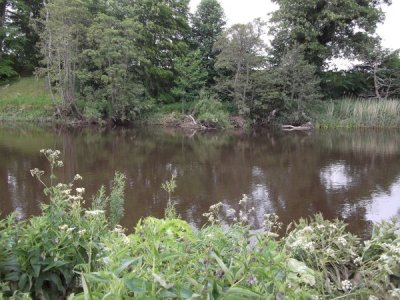

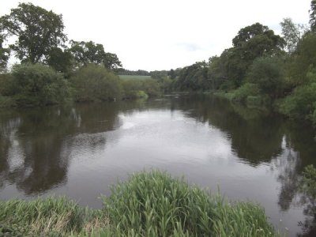

To make your way backup the bank, you do so through a small series of beautifully landscaped ponds joined by ornamental bridges and pathways. Stunning is a good word to describe the 'living picture' that unfolds before your eyes. As you will see from the photographs the ponds are 'natural' and consist of a lily pond, a rush pond and a wildlife pond. All are beautifully landscaped with an amazing variety of flowers, bushes and trees; perfectly placed to show-off each pond to full effect.

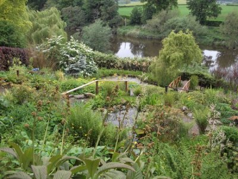

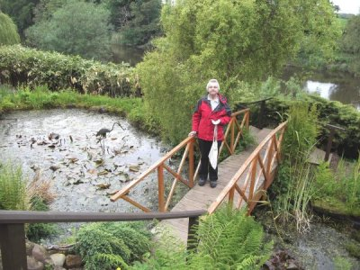

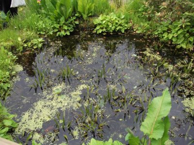

*Views of the ponds*

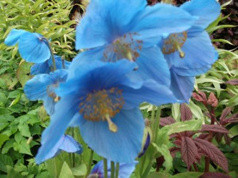

*Beautifully landscaped gardens and flowers.*

If you are in the Kelso area then make a visit to the Teviot Smokery a priority. You will not be disappointed.
