*Text and photographs by David Marshall*

The Blue Reef at Newquay, Cornwall is located in one of the most picturesque settings of any Public Aquarium in the U.K. Set nicely into the cliff side at Towan Beach, it is surrounded by both natural and man-made beauty. However, for the visitor, there is a slight downside to the location as there is limited vehicle access and however you approach on foot the access footpaths to the building are fairly steep.

<!--more-->

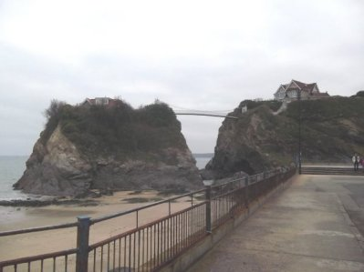

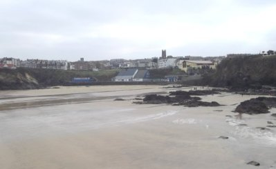

*The Blue Reef at Newquay is surrounded by stunning natural and man-made beauty*

As you approach Towan Beach from the town centre you can see the Blue Reef building (in the centre of our photograph)

As Sue and I paid our entrance fees and entered the building, I was aware that the ambience did not match that of the other members of the Blue Reef chain that we have visited in recent years. However, first impressions can be very deceptive and here you will find some very impressive, and one stunning, aquarium exhibits.

As I report so often these days, the Aquarium follows the American plan of having around thirty exhibits that vary greatly in size and design.

As you can see this very 'nosey' Spiny Lobster likes to know what is going on around him.

The first eight exhibits are dedicated to native marine life. The largest of these is the lagoon exhibit, where a beautifully arranged rock and kelp background is used to show Turbot, Thornback rays, Sea bass and Gilthead bream to full effect. Sue was taken by the two rockpool displays and asked me to mention that these are the best such displays she remembers seeing at any Public Aquarium and that our photographs give a good idea of what these displays were like but don't do them full justice.

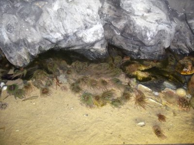

*A rockpool display. As they are throughout the Aquarium the information boards are excellent.*

*A closer look at some of the rockpool inhabitants*

Now we move on to tropical freshwater exhibits. The first of these is a small aquarium containing a mixture of Amazonian characins. Their larger cousins follow in the form of eight Red-bellied piranha housed in a 6' home. The 18' aquarium that follows is wonderful and houses a host of 'monster fish' including Pearl arowana, Marbled Oscar cichlids, huge Red hook metynnis, variously sized Clown loaches and Pike cichlids; all ruled over by an extremely large Giant gourami.

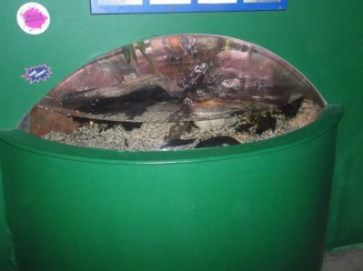

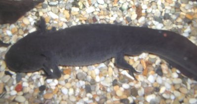

*This bubble aquarium houses some beautiful normally coloured and albino Axolotls.*

*One of the residents*

Moving through a doorway brings the visitor face-to-face with one of the most amazing aquarium exhibits I have seen. Sue and I cannot explain, or our photographs show, what this tropical freshwater biotope is actually like. There are tangled roots in the water and above it various foliage and rock platforms. You literally cannot see the water for cichlids. There are huge shoals of Geophagine species with smaller numbers of Convicts and Green terrors. Non-natural cichlids are here also in the form of Asian Red parrots and various Angelfish variants that are produced in the Czech Republic. Catfish are not forgotten, with various large loricarins and a Giraffe catfish wandering around. A large Night tetra was also lurking in the roots. Various Turtles were both in the water and on land. So could there be any more 'stars' here? Well most visitors had come to view the two resident Cuviers dwarf caiman. What spectacular creatures these are, although they did disappoint their 'fans' with a very tame approach to eating the raw flesh of marine fish the staff offered them - via a large feeding pole.

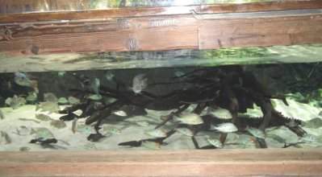

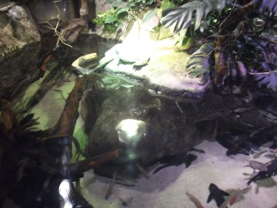

*A below the waterline view of the biotope exhibit.*

*A taste of the foliage and rock platforms above the waterline.*

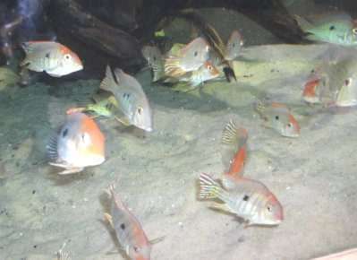

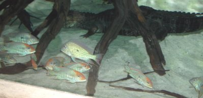

*Some of the amazing cichlids.*

As we find ourselves in the second part of the displays we have five aquariums displaying the 'weird and wonderful', from a Giant Pacific octopus, to menacing Wolf fish to the unbelievable shape and beauty of Pipefish.

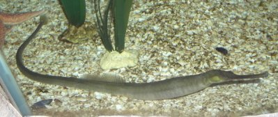

*One of several Pipefish.*

These displays lead onto a walk-through tropical marine tunnel complete with fish including Panther grouper, Unicorn fish, smaller species of Sharks, Fingerfish and Batfish.

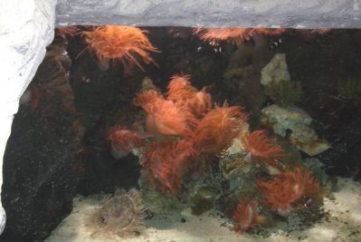

*This beautiful Red anemone display follows the tunnel*

To complete the visit there is a mixture of native and tropical marine displays which, at the time of our visit, varied in quality. My favourite was the 'keep them at home' aquarium display that contained some stunning Foxfaces, Hawkfish, Cleaner wrasse and Yellow tang.

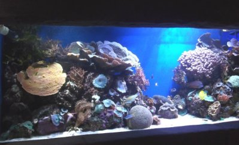

Finally, I enjoyed the Blue Reef at Newquay and this Public Aquarium is well worth a visit. The biotope aquarium is worth the entry fee alone and if you could re-create this at home, in a large conservatory, you would never want to set foot outside your front door again!
