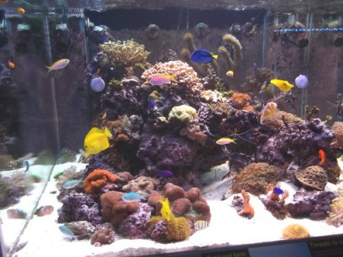
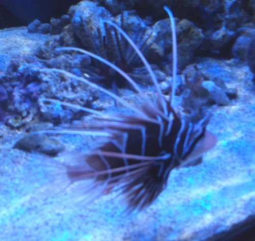
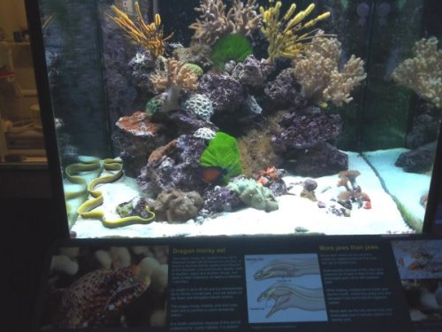
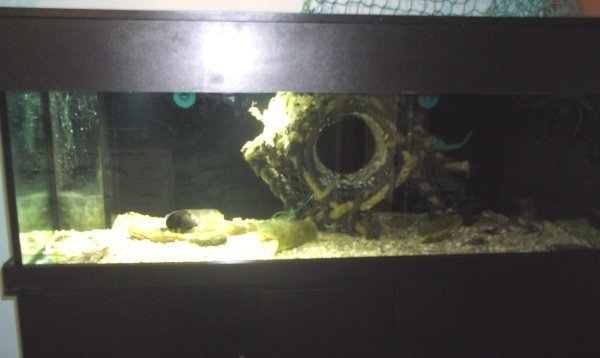

*Text and photographs by David Marshall*

### A helping hand?

On 16th July 2013, the Falmouth Aquarium made national media headlines in the U.K. when press reports from the Western Morning News were syndicated to several major newspapers and news websites. These reports concerned an SOS that was sent out from the Aquarium owners to the St Austell Brewery. With the U.K. suffering from an exceptional heat wave, aquariums housing both native and tropical marine creatures at the Aquarium had begun to badly overheat. Knowing that the Brewery had helped the National Lobster Hatchery overcome similar problems a few years earlier by installing vital beer-chilling systems, the SOS call was made.

<!--more-->

The Brewery responded by sending along their Technical Services Manager who not only installed the chilling equipment but who also announced that the Brewery would not be taking this equipment back leaving it as a donated item for the use of the Aquarium.

Our visit

A few weeks earlier Sue and I had made our first visit to the Falmouth Aquarium. We were looking for a modern building but found 23 Church Street (which lies in the main shopping area behind the harbour) to be a four-storey Georgian House. As we entered the premises, the young lady manning the entrance kiosk told us that before the Aquarium exhibits were put into place the floor had to be specially strengthened to take their full weight.

By the time we left both of us were very impressed by this small Public Aquarium and Sue was left in no doubt that this was one, if not the, most lovingly cared for Public Aquarium that we have had the pleasure of visiting during our travels.

The first floor

Here you will find nine themed tropical marine aquariums displaying fish and various aquatic creatures large and small. My favourite was the 'Anatomy of a coral reef' that is a stunning display of living corals complete with some of the highest quality fish I have ever seen. The Lionfish display uses blue lighting that captures the colours and moods of these amazing predators to their full advantage. In comparison, the Black and Green seahorses looked so dainty but this was a little deceptive as they showed a beautiful Firefish Goby that they were the creatures in charge.

*A Lionfish showing full colours under strong blue lighting*

All of the displays have excellent information boards and this was especially true of the one containing Dragon Moray Eels. I learned much I didn't know about these sleek predators.

*The Dragon Moray Eel display.*

*The second floor*

This area is home to four large native marine exhibits. What struck us immediately was that these exhibits are not over-stocked, giving the various fish and crustaceans plenty of space to move around in comfort.

The first display features a Yellow-Finned Black Bullhead that has Prawns for company. The second features five large Crabs in the company of Ling and a Sea Scorpion. The third features a shoal of Mullet that have a large Blue Lobster for company. Wrasse occupy the final exhibit on this floor.

*Part of the Mullet shoal.*

*The Wrasse exhibit*

Here is a very mixed display of 'treasures of the sea' including various shells and a grand collection of aquatic fossils.

### The fourth floor

This is an interactive area where you can obtain a whole wealth of information not only about the sea life around Falmouth but also from around the World. Sue says that this area puts the educational facilities at some of our larger Public Aquariums to shame.

Not a criticism, but a surprise, that no mention of the Falmouth Sea Monster is made but you cannot have everything.

### Conclusion

If you are in the Falmouth area then this is a 'must visit' for all fishkeepers. A beautiful small Public Aquarium with all the signs that somebody, with a great love of tropical marines, has taken this from hobby to visitor attraction level.
