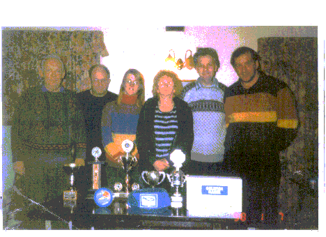

The Society began life in February 1985 as the Ryedale Aquarist Club. Then, as now, the aim was to provide fishkeepers in the Ryedale area of North Yorkshire, England with a monthly meeting at which such people, whatever their line of interest in the aquarium hobby, could get together and discuss aquarium fish.

At our meetings (see the relevant page on our site for current details) we not only talk fish but have guest speakers who join us and provide information on their experiences with aquarium fish and trips abroad etc., social evenings with the members of neighbouring Aquatic groups, 'fun quizzes' and end the year with a Christmas party.

Although we hold an annual open show (see the relevant page for details) and give our members the chance to bring their fish along to a monthly table show we are NOT a showing Society as such thus showing fish at our meetings is not a condition of membership.

As a Society we are affiliated to the Yorkshire Association Of Aquarist Societies (Y.A.A.S.), the Federation Of British Aquatic Societies (F.B.A.S. who can provide details of aquatic groups throughout the U.K. on [www.fbas.co.uk](https://www.fbas.co.uk)) and the Tyne Tees Area Association F.B.A.S. We take our membership of these bodies very seriously.

In 2008 we 'twinned' with fellow T.T.A.A. and Y.A.A.S. members STAMPS (see our links sections for details of the STAMPS website). We hold an annual 'Twinning Day' at which we make the most of our friendship.

## From our early years

Our emblem is the Black Widow Tetra, chosen in 1987 when we joined the F.B.A.S. Read [the story of our emblem]() to find out how a blindfold and a drawing pin picked it.

From 1990 we held our monthly meetings at the Bay Horse Hotel, Market Place, Pickering, in the main function room, beginning at 7.30p.m.

We kept in touch with fellow Aquatic Societies and other U.K. Federations/Associations through 'swapping' our monthly publication, Ryedale Reporter, for a variety of aquatic publications. Ryedale Reporter was an A4 publication, with around 12 pages per issue, and contained articles written by our members and friends.

Our members were also members of several specialist groups e.g. Catfish Study Group (U.K.), with Mr. David Marshall editing Viviparous magazine for the Livebearer Information Service, and had individual memberships of other Associations e.g. Association Of Aquarists'.

Our first web site went online in 2002, and our thanks went to the staff at the Pickering Centre of Askham Bryan College for their advice and encouragement in setting it up.

*Several of our members say hello on our first web site, around 2002. Photograph is copyright of Mr. G. Grayson.*

If you have stayed with us this far you may be wondering exactly what and where Ryedale actually is? We are a rural area of North Yorkshire, England that covers the market towns of Pickering, Malton, Helmsley, Kirkbymoorside and a large number of surrounding villages. On a map you will find us halfway between Whitby to the north and York to the south.

The members hope you enjoy our web site, even if you are only browsing through, and further information about Ryedale A.S,. can be obtained from the following e-mail address:-[ryedaleaquaristsociety@yahoo.co.uk](mailto:ryedaleaquaristsociety@yahoo.co.uk)
